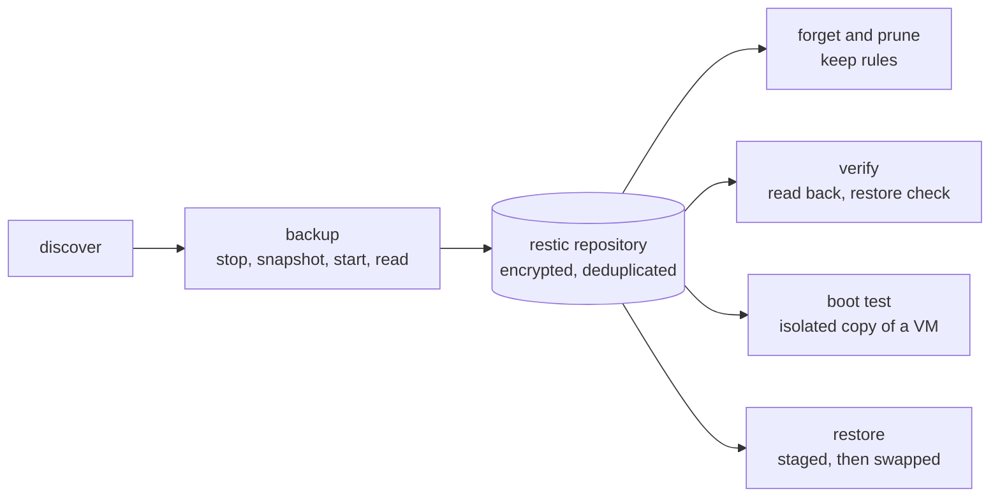
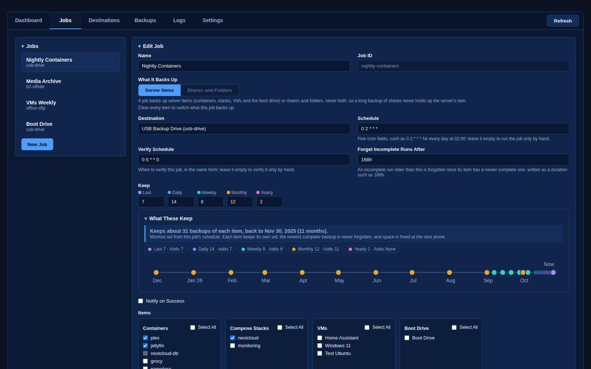
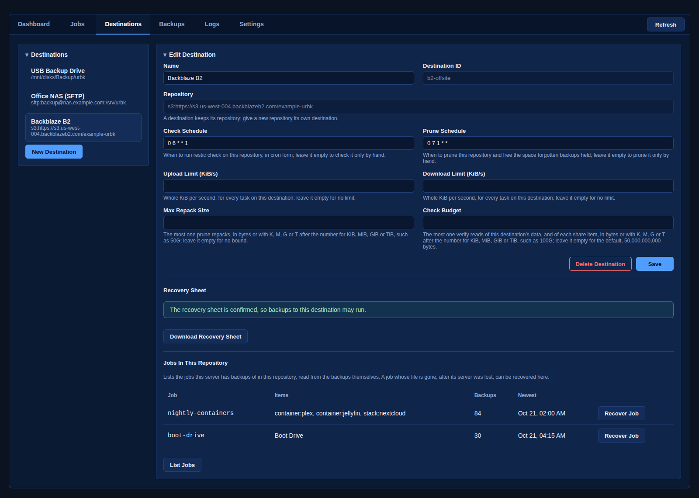
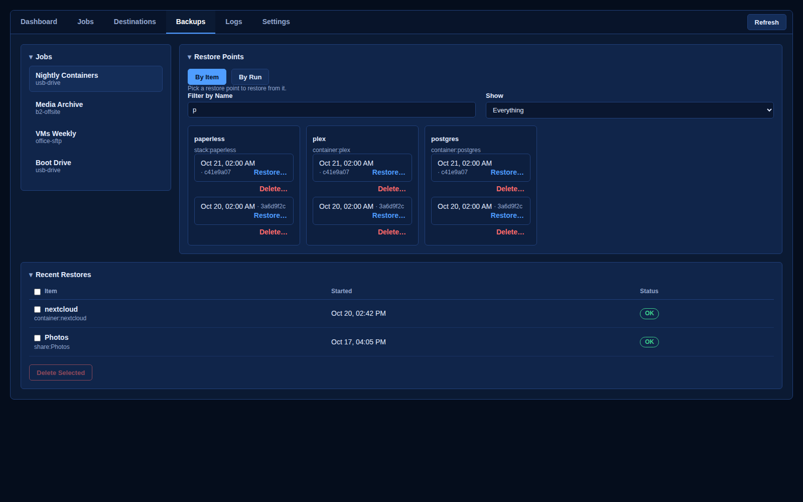
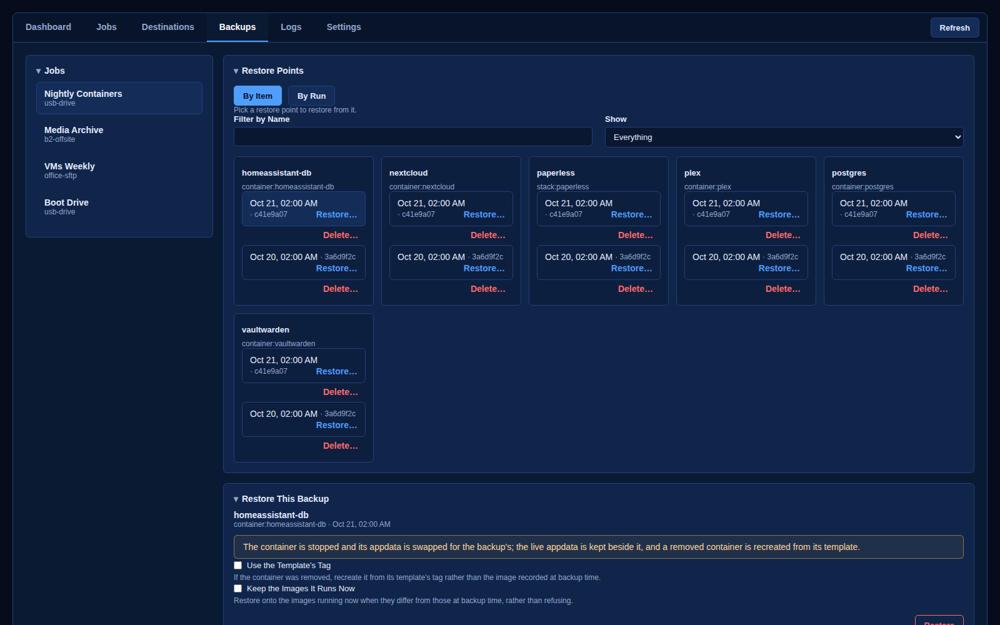
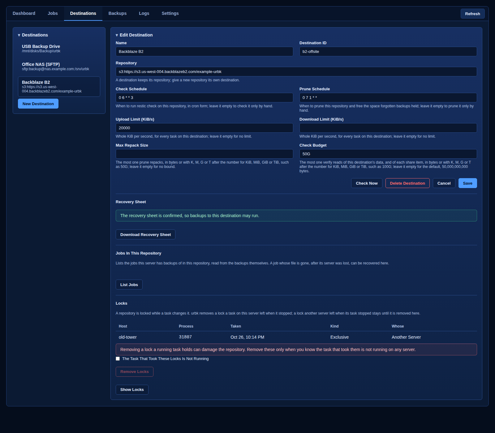

  

<h1 align="center">urbk</h1>

<em>Consistent, encrypted, verified backups of everything your Unraid server runs.</em>

Backup and restore for an Unraid server: its Docker containers, compose
stacks, VMs, boot drive and user shares. urbk finds what the server runs,
backs it up consistently into an encrypted, deduplicated
[restic](https://restic.net) repository, checks that the backups restore, and
puts things back when a container, a VM, a share or the whole server needs
rebuilding.

It runs on the server itself, as a plugin with its own page under
Settings > User Utilities, or as **Backups** on Unraid's top bar if you
choose, and needs no account or cloud service of ours.

## Status

urbk is not released yet. This page shows what it does; the plugin is not
available to install.

## Why not just rsync?

Many Unraid servers are backed up with rsync scripts or Syncthing, which keep
a mirror: a second copy that looks like the first. A mirror copies mistakes as
faithfully as it copies files. urbk keeps versions instead.

| | rsync or Syncthing mirror | urbk |
|---|---|---|
| A folder deleted by mistake | deleted on the copy at the next sync | still in every earlier backup |
| Files encrypted by ransomware | the encrypted files replace the good copy | backed up as a new version; the clean versions stay until the keep rules drop them |
| Going back to last Tuesday | not possible, unless you script dated copies | pick any kept backup in the Backups tab |
| A 60 GB VM disk that changed a little | copied again, or kept twice | only the changed chunks are stored |
| A copy on someone else's storage (B2, S3, a friend's NAS) | readable by whoever runs that storage | encrypted; the storage sees only scrambled chunks |
| Knowing the copy is good | you find out when you need it | verify reads backups back and restores samples on a schedule |
| Containers and VMs mid-write | copied as they are, possibly half-written | stopped or snapshotted for a consistent copy, then started again |
| The server itself dies | rebuild by hand from your notes | attach the destinations from their recovery sheets, adopt the old server ID, recover the jobs, restore |

What a mirror does better: you can open the copy in any file manager. With
urbk you press Browse… beside any share or boot drive backup in the Backups
tab to look through its files, read only, and stage the ones you pick into a
folder.

urbk stores backups with [restic](https://restic.net), a widely used
open-source backup engine. A repository urbk writes can be read with restic
alone, with the location and password on its recovery sheet and the
location's own credentials.

## What it backs up

| Item | Backed up | Restored as |
|------|-----------|-------------|
| Docker container (Unraid template) | template XML, its appdata and other in-scope mounts, named volumes, image reference and digest | the container recreated from its template, data back in place |
| Compose stack (compose.manager) | project folder, `.env`, override, mounts and volumes of its containers, each service's image digest | the stack back in place, brought up on the recorded images |
| VM (libvirt) | domain XML, NVRAM (UEFI), TPM state (swtpm), every file or zvol disk | the VM defined again with its disks, NVRAM and TPM state, or one of its disks staged as an image beside it, the VM left untouched |
| Boot drive | `/boot`, except the Unraid release files and urbk's own secrets | the whole boot drive, or only the files and folders you pick, staged into a folder for you to copy back |
| User share, or a folder of one | its files on every disk and pool that holds them, with excludes you choose | the chosen files and folders, into a new folder of their own or over the live share after a preview you confirm |

A job holds either server items (containers, stacks, VMs, the boot drive) or share
items, never both, so a long share backup never holds up the backups of the
server itself.

## Where it keeps backups

Any destination restic can reach, set up from the Destinations tab:

- a folder on a pool, a user share or an external drive of this server;
- SFTP, with a key urbk makes and a host key you confirm;
- S3, AWS or any S3-compatible service, Google Cloud Storage included (with an
  HMAC key); Backblaze B2;
- an SMB or NFS share on another machine, which urbk mounts only while it
  uses it;
- OneDrive or Google Drive, through urbk's own pinned copy of
  [rclone](https://rclone.org). You sign in once with rclone on a computer
  with a browser (with your own Google OAuth client for Google Drive) and paste
  what `rclone config show` prints; urbk keeps it private and keeps only the
  keys that drive signs in with. Connect Drive lists the drive's folders and
  marks the ones already holding a backup. Cloud drives throttle heavy traffic
  (Google Drive takes about 750 GB a day), so they suit the boot drive,
  appdata and VM definitions rather than large shares.

Each destination has its own repository password, shown once on a recovery
sheet you download and confirm by typing it back before its first backup. The
sheet also prints this server's ID, which a replacement server adopts.
Upload and download limits, the most a prune repacks, and how much a verify
reads are set per destination.

## How it works

- **Discovered, not typed in.** Containers, stacks, VMs, shares, their
  mounts, disks and datasets come from the server itself.
- **Down for seconds, not for the whole backup.** On ZFS, a running
  container or stack is stopped only while urbk takes a snapshot of its data,
  then started again and read from the snapshot while it runs; a container is
  typically back in about three seconds. A VM is shut down only for its
  snapshot and booted again before its disks are read. Off ZFS, an item is
  stopped for its read and started again. Either way the backup is
  application-consistent. A share is read through read-only mounts of each
  disk and pool that holds it. When a backup can only be crash-consistent,
  its record says so.
- **Crash-safe.** Every step that changes the server is journaled. If a run
  dies part way, the next urbk command replays the journal: it starts again
  what it stopped, and puts back or finishes a restore that was cut short.
- **Restores stage first.** A restore writes beside the live copy and swaps it
  in, keeping the previous copy; if the swap fails, it rolls back. A share
  restore writes into a new folder of its own, or over the live share only
  after a preview of what it writes over that you confirm. The boot drive, and
  a single VM disk, are only ever staged into a folder; the live ones are never
  written.
- **A compose stack is backed up whole.** Its containers are read with it,
  so the Jobs tab greys them and says on hover which stack backs them up. A
  job that still lists one beside its stack records it as covered by the
  stack rather than failing it. Its services stop and start in dependency
  order, those that don't depend on each other together, so a stack is down
  for one stop grace per wave rather than one per service.
- **Says which service had to be killed.** A service that does not stop
  within urbk's stop grace is killed by Docker, and the run names it and says
  how long its stop took, with a hint on what to change.
- **Find a backup fast.** The Backups tab filters a job's items by name, and
  for a job holding several kinds, shows only containers, stacks or VMs.
- **Restore one item or a whole run.** Pick an item and one of its backups, or
  pick a backup run and tick several of its containers, stacks and VMs to
  restore them one after another, stopping at the first that fails.
- **Delete what you no longer need.** Delete one backup, several from the same
  run, or a job together with all its backups. Deleting an item's only backup
  asks you to type its name, and the space comes back at once or at the
  destination's next scheduled prune, your choice.
- **Long backups share the server.** A first backup of a big share can take
  days. It runs in steps, each saved as a snapshot as it finishes, and gives
  urbk's lock up between steps so the server's own backups still run; the
  Dashboard shows the step it is on, the bytes backed up so far, and when the
  item it is on started as well as the run. Before
  the first upload of a share to a remote destination, urbk estimates its
  size and the time and cost it will take, and waits for you to confirm.
- **A backup counts once it restores.** Verify reads part of a repository's
  data back on a schedule, in rotation, and restores a sample of each item;
  boot test starts a VM's newest backup as an isolated copy with no network
  and no host devices, then removes it.
- **See at a glance whether the server is protected.** The Dashboard's
  Health panel counts jobs, last runs OK, never run and not OK, and warns
  about what needs you: no schedule, items in no job, a run, verify, check or
  prune that did not pass or is overdue. It says all is well only when every
  job is scheduled and last ran OK, every item is in a job, and every verify,
  check and prune ran on time and passed. Unprotected lists the containers,
  stacks and VMs no job backs up, without listing shares, which would wake
  sleeping disks.
- **Keep rules you can see.** As you type a job's keep rules, the job editor
  says how many backups of each item they hold and how far back, on the job's
  own schedule, with a timeline whose dots name the rules that keep them.
- **Lose the server, keep the backups.** A new server needs only the
  recovery sheets: attach each destination with its password, adopt the old
  server's ID in Settings, Server Recovery, and list each destination's jobs
  to recover the ones whose files died with the boot device. Restore the boot
  drive first, then everything else. Before it asks, Adopt Server ID checks
  every destination and says when, where and by which machine the ID was last
  claimed, so a server that is still running is not adopted by mistake. urbk
  refuses an adopt that would strand backups or that names an ID no
  destination holds.
- **One server ID, one machine.** Every claim urbk writes on a destination
  names the machine that wrote it, so a second server running under the same
  ID is refused before it writes anything. A server whose state folder was
  rebuilt says so with This Is Still This Server in Settings, Server
  Recovery, and its next backups take its claims back. After a backup the
  claim is written before any old backup is forgotten, so a backup that cannot
  show its server still writes to a destination forgets nothing there.
- **Stopping the array is safe.** urbk stops its runs and releases every disk
  before Unraid unmounts them, and starts nothing until the array is back.
- **Secrets stay off the command line.** Passwords and keys live on the boot
  drive, readable by root only, and reach restic through files. A location's
  credentials are scrubbed from urbk's errors, notifications and records.
- **A busy repository says so.** When another task holds a repository, the
  Backups tab says which task and since when, and lists its restore points
  by itself once that task ends, instead of showing restic's lock error.
- **A lock a crashed run left clears itself.** When a restic on this server
  stopped without removing its lock (killed, crashed, or the server lost
  power), the next backup, prune or delete removes that lock and goes on,
  instead of failing until someone runs `restic unlock` by hand.
- **A lock another server left, removed when you say so.** A destination's
  Locks section lists each lock on its repository: which host took it, its
  process, when and its kind, and whether it is this server's. Remove Locks
  takes them away only once you tick that the task holding them is not
  running; it is refused while a task on this server still holds one, when
  urbk cannot tell whose a lock is, or when the locks changed since you
  looked.
- **You can tell it is working.** Every line that says urbk is still at it
  (reading from the server, checking, deleting, the task Running Now) ends in
  a moving trail of dots, so a slow cloud listing never looks stuck.
- **Tools you can check.** Settings lists the restic and rclone urbk runs,
  each with its SHA-256 against the version it pins, and says Not Verified
  with the reason if either is not the pinned build.
- **Settings that help.** Show urbk on Unraid's top bar, pick the folder the
  boot drive and Stage Disk pickers start in, send a test notification to
  check alerts reach you, and download a diagnostics file for a bug report
  that holds no repository, job, destination or secret.
- **Everything from the shell too.** Every action in the GUI is a `urbk`
  command that prints JSON.

## The GUI

The screenshots show invented jobs, shares and servers, not a real one.

| Dashboard | Logs |
|:---:|:---:|
|  |  |
| Health and what needs you, items no job backs up, how long each run took and how many items it backed up, and what is overdue | Every run, verify, check, prune and restore, with each item's result |

| Jobs: Server Items | Jobs: Shares and Folders |
|:---:|:---:|
|  |  |
| Containers, stacks, VMs and the boot drive, with schedule, keep rules and verify schedule; a stack's containers are greyed, since the stack backs them up | Shares and folders inside them, each with what is left out |

| Destinations | Settings |
|:---:|:---:|
|  |  |
| Where backups go, their limits, checks and recovery sheets | This server's ID and the tools urbk uses, the top-bar option, the default stage folder, and Server Recovery: the steps for a new server, Adopt Server ID, and This Is Still This Server |

| Keep Rules | Recover a Lost Server's Jobs |
|:---:|:---:|
|  |  |
| What a job's keep rules hold on its schedule, rule by rule, with a timeline | Jobs In This Repository lists the jobs a destination holds backups of; Recover Job brings back one whose file was lost |

| Backups | Restore a Whole Run |
|:---:|:---:|
|  |  |
| Pick an item and a backup, browse a share's files, and restore | Tick several items of one backup run and restore them together |

| Boot Drive Files | Stage a VM Disk |
|:---:|:---:|
|  |  |
| Browse a boot drive backup and stage only the files you pick | Stage one disk of a VM as an image, on a pool, a drive or an array disk |

| Find a Backup | Restore One Item |
|:---:|:---:|
|  |  |
| Filter a job's items by name, or show only one kind | Pick one of an item's backups; the panel says what the restore does before it does it |

| Locks | |
|:---:|:---:|
|  | |
| A destination's locks: whose each is and when it was taken, and Remove Locks once you confirm the task is not running | |

| Delete a Backup | Delete a Job and Its Backups |
|:---:|:---:|
|  |  |
| Every backup has its own red Delete beside its Restore; deleting several asks once | See what would be deleted before anything is |
