# urbk

Backup and restore for an Unraid server: its Docker containers, compose
stacks, VMs, boot drive and user shares. urbk finds what the server runs,
backs it up consistently into an encrypted, deduplicated
[restic](https://restic.net) repository, checks that the backups restore, and
puts things back when a container, a VM, a share or the whole server needs
rebuilding.

It runs on the server itself, as a plugin with its own page under
Tools > Utilities, and needs no account or cloud service of ours.

## Status

urbk is not released yet. This page shows what it does; the plugin is not
available to install.

## What it backs up

| Item | Backed up | Restored as |
|------|-----------|-------------|
| Docker container (Unraid template) | template XML, its appdata and other in-scope mounts, named volumes, image reference and digest | the container recreated from its template, data back in place |
| Compose stack (compose.manager) | project folder, `.env`, override, mounts and volumes of its containers, each service's image digest | the stack back in place, brought up on the recorded images |
| VM (libvirt) | domain XML, NVRAM (UEFI), TPM state (swtpm), every file or zvol disk | the VM defined again with its disks, NVRAM and TPM state, or one of its disks staged as an image beside it, the VM left untouched |
| Boot drive | `/boot`, except the Unraid release files and urbk's own secrets | the whole boot drive, or only the files and folders you pick, staged into a folder for you to copy back |
| User share, or a folder of one | its files on every disk and pool that holds them, with excludes you choose | the chosen files and folders, into a new folder of their own or over the live share after a preview you confirm |

A job holds either server items (containers, stacks, VMs, the boot drive) or share
items, never both, so a long share backup never holds up the backups of the
server itself.

## Where it keeps backups

Any destination restic can reach, set up from the Destinations tab:

- a folder on a pool, a user share or an external drive of this server;
- SFTP, with a key urbk makes and a host key you confirm;
- S3, AWS or any S3-compatible service; Backblaze B2;
- an SMB or NFS share on another machine, which urbk mounts only while it
  uses it.

Each destination has its own repository password, shown once on a recovery
sheet you download and confirm by typing it back before its first backup.
Upload and download limits, the most a prune repacks, and how much a verify
reads are set per destination.

## How it works

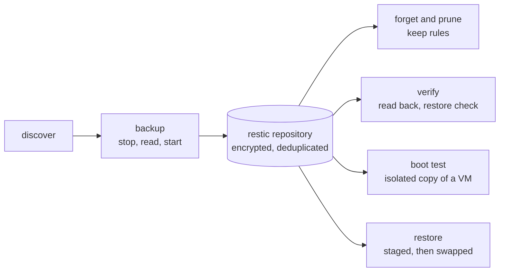

- **Discovered, not typed in.** Containers, stacks, VMs, shares, their
  mounts, disks and datasets come from the server itself.
- **Consistent where it can be.** A running container or stack is stopped for
  its read and started again, and a VM is shut down for its read. A share is
  read through read-only mounts of each disk and pool that holds it. When a
  backup can only be crash-consistent, its record says so.
- **Crash-safe.** Every step that changes the server is journaled. If a run
  dies part way, the next urbk command replays the journal: it starts again
  what it stopped, and puts back or finishes a restore that was cut short.
- **Restores stage first.** A restore writes beside the live copy and swaps it
  in, keeping the previous copy; if the swap fails, it rolls back. A share
  restore writes into a new folder of its own, or over the live share only
  after a preview of what it writes over that you confirm. The boot drive, and
  a single VM disk, are only ever staged into a folder; the live ones are never
  written.
- **Restore one item or a whole run.** Pick an item and one of its backups, or
  pick a backup run and tick several of its containers, stacks and VMs to
  restore them one after another, stopping at the first that fails.
- **Delete what you no longer need.** Delete one backup, several from the same
  run, or a job together with all its backups. Deleting an item's only backup
  asks you to type its name, and the space comes back at once or at the
  destination's next scheduled prune, your choice.
- **Long backups share the server.** A first backup of a big share can take
  days. It runs in steps, each saved as a snapshot as it finishes, and gives
  urbk's lock up between steps so the server's own backups still run; the
  Dashboard shows the step it is on and the bytes backed up so far. Before
  the first upload of a share to a remote destination, urbk estimates its
  size and the time and cost it will take, and waits for you to confirm.
- **A backup counts once it restores.** Verify reads part of a repository's
  data back on a schedule, in rotation, and restores a sample of each item;
  boot test starts a VM's newest backup as an isolated copy with no network
  and no host devices, then removes it.
- **Stopping the array is safe.** urbk stops its runs and releases every disk
  before Unraid unmounts them, and starts nothing until the array is back.
- **Secrets stay off the command line.** Passwords and keys live on the boot
  drive, readable by root only, and reach restic through files. A location's
  credentials are scrubbed from urbk's errors, notifications and records.
- **Everything from the shell too.** Every action in the GUI is a `urbk`
  command that prints JSON.

## The GUI

The screenshots show invented jobs, shares and servers, not a real one.

| Dashboard | Logs |
|:---:|:---:|
| 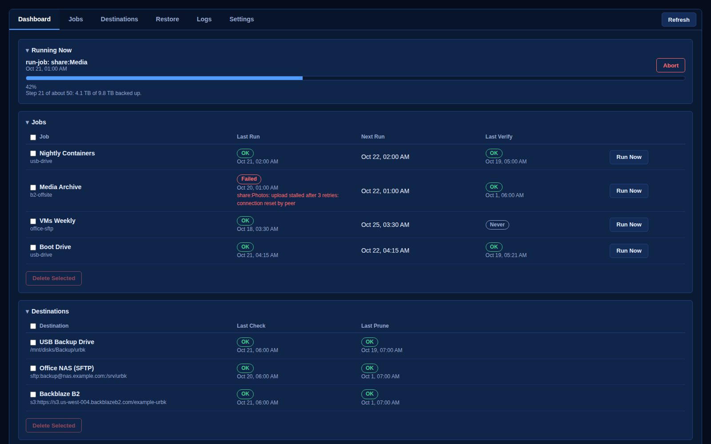 | 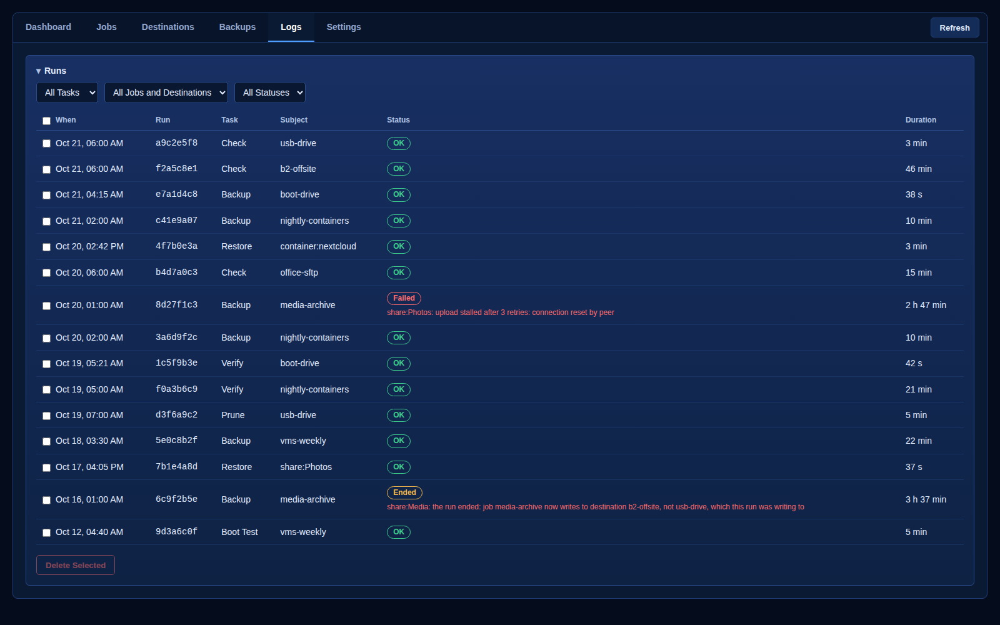 |
| What ran, what is running (with Abort), what is next, and what needs you | Every run, verify, check, prune and restore, with each item's result |

| Jobs: Server Items | Jobs: Shares and Folders |
|:---:|:---:|
| 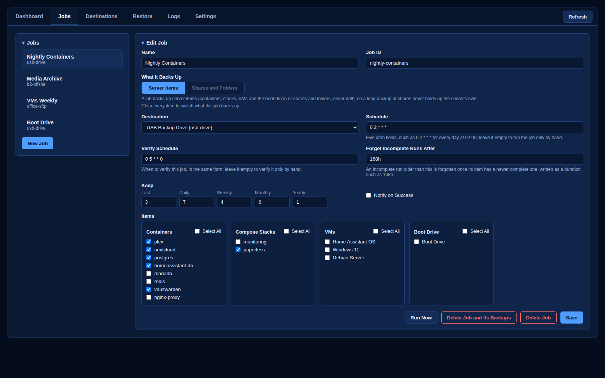 | 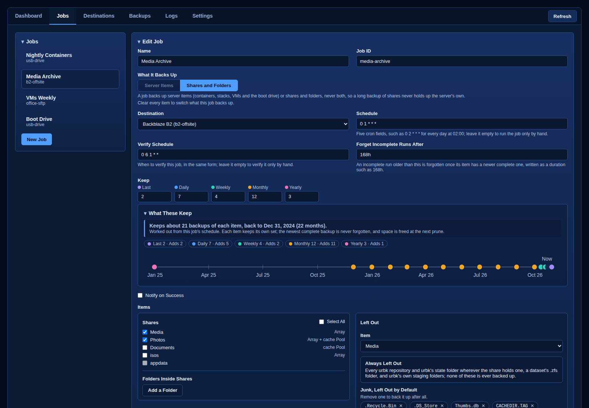 |
| Containers, stacks, VMs and the boot drive, with schedule, keep rules and verify schedule | Shares and folders inside them, each with what is left out |

| Destinations | Settings |
|:---:|:---:|
| 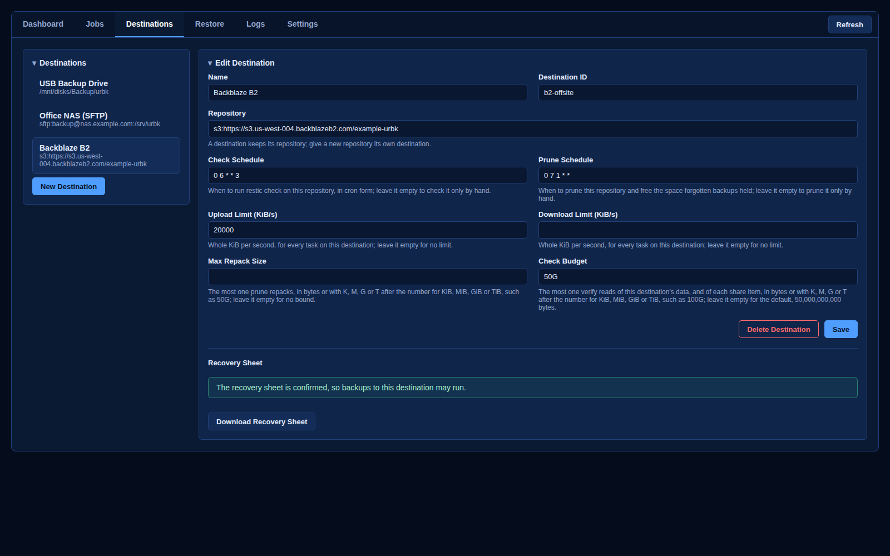 | 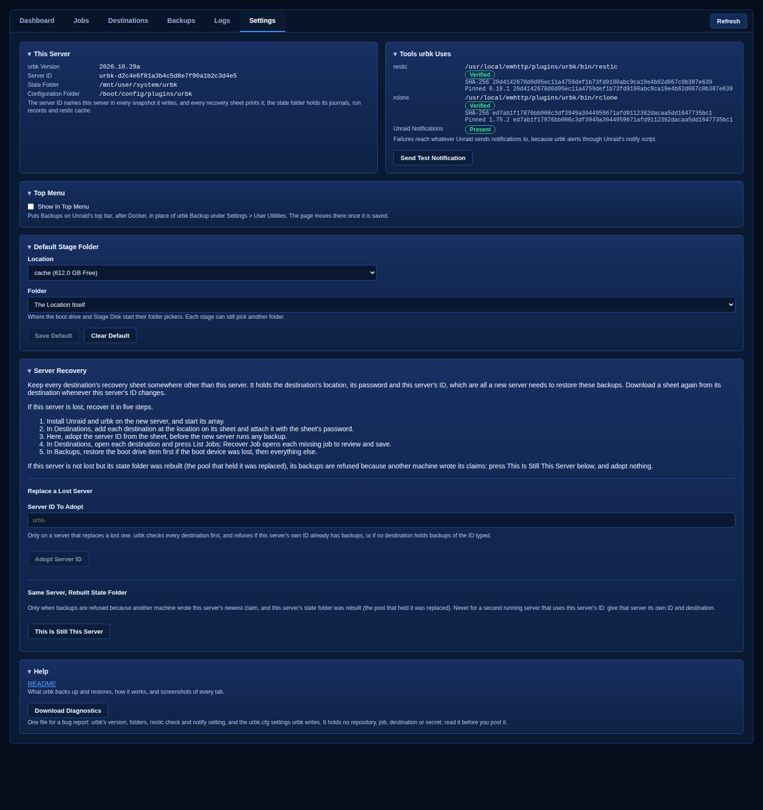 |
| Where backups go, their limits, checks and recovery sheets | This server's ID and folders, and the tools urbk uses |

| Restore | Restore a Whole Run |
|:---:|:---:|
| 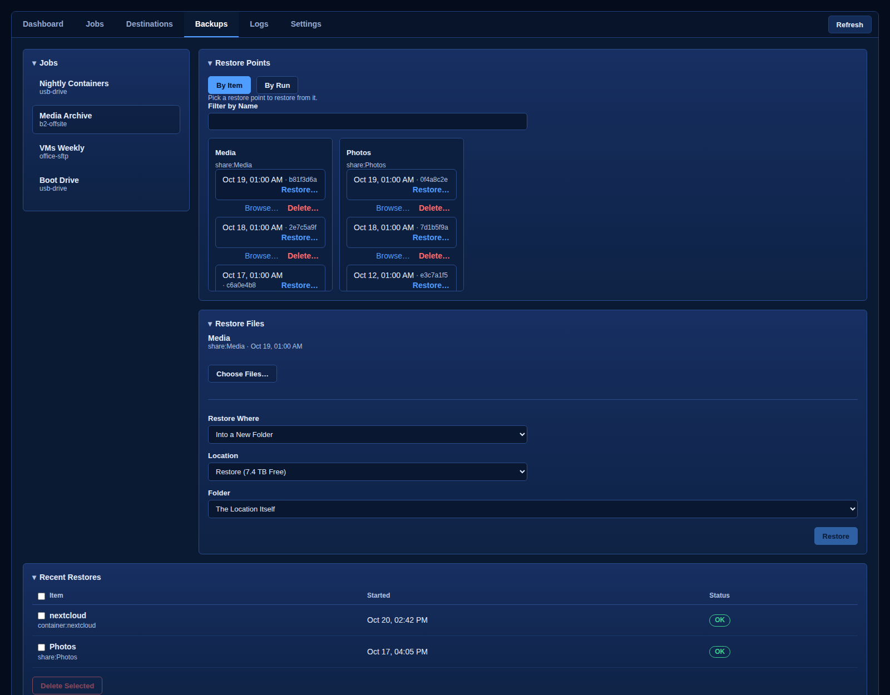 | 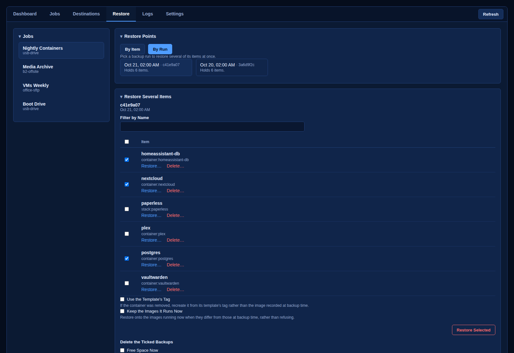 |
| Pick an item and a backup, browse a share's files, and restore | Tick several items of one backup run and restore them together |

| Boot Drive Files | Stage a VM Disk |
|:---:|:---:|
| 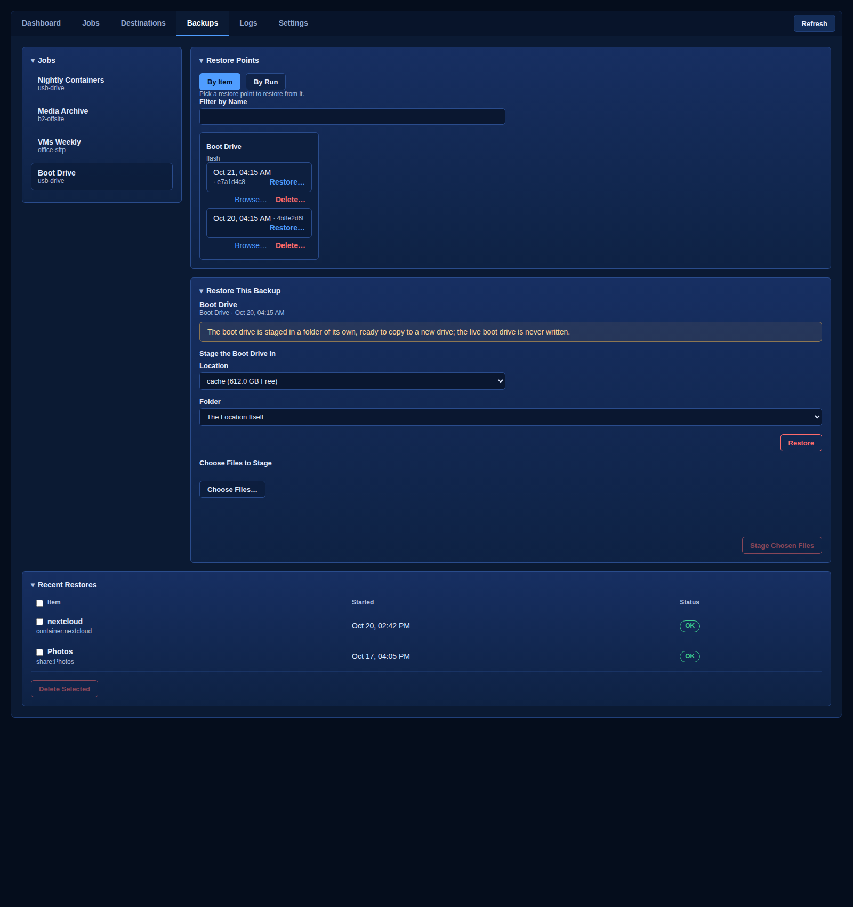 | 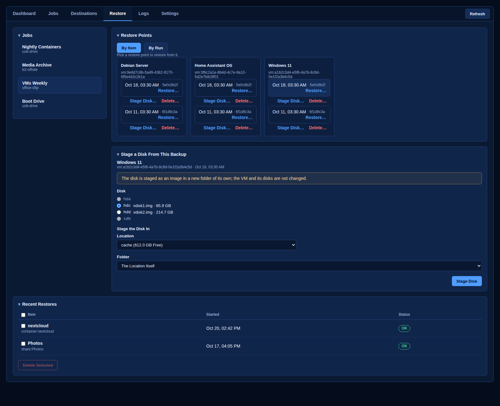 |
| Browse a boot drive backup and stage only the files you pick | Stage one disk of a VM as an image, on a pool, a drive or an array disk |

| Delete a Backup | Delete a Job and Its Backups |
|:---:|:---:|
| 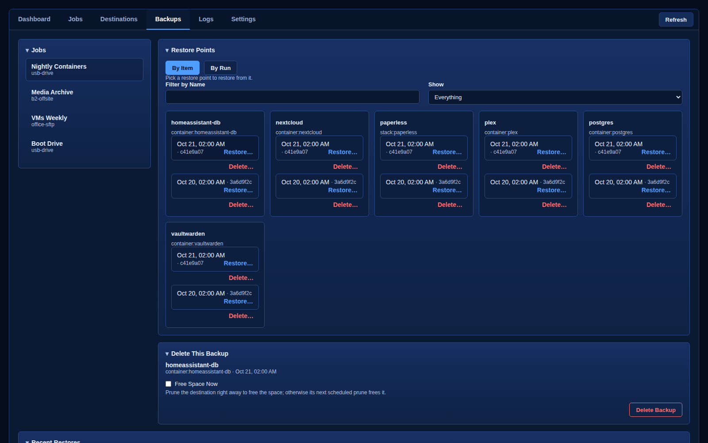 | 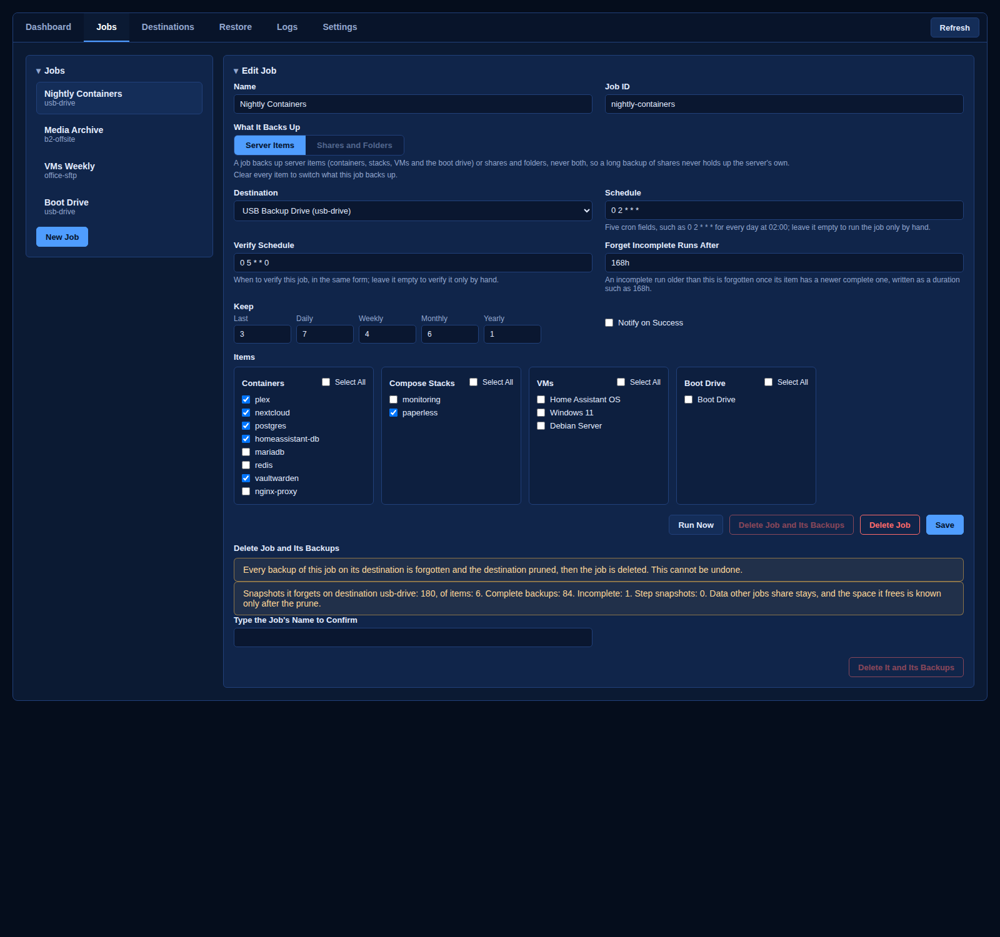 |
| Every backup has its own red Delete beside its Restore | See what would be deleted before anything is |
