# urbk User Manual

urbk backs up an Unraid server: its Docker containers, compose stacks, VMs,
boot drive and user shares, into encrypted restic repositories, and restores
them. This manual walks through the page urbk adds to Unraid, tab by tab, and
says what each panel, field and button does. It describes urbk 2026.11.13a.

Names in **bold** are what the page shows, word for word.

## Contents

1. [Getting Around](#1-getting-around)
   - [Installing, updating and removing](#installing-updating-and-removing)
   - [Arranging the sections](#arranging-the-sections)
2. [The Dashboard](#2-the-dashboard)
   - [Health](#health)
   - [Needs Attention](#needs-attention)
   - [Unprotected](#unprotected)
   - [Backed Up Elsewhere](#backed-up-elsewhere)
   - [Running Now](#running-now)
   - [Jobs](#jobs)
   - [Destinations](#destinations)
   - [Recent Activity](#recent-activity)
   - [Queue](#queue)
3. [Jobs](#3-jobs)
   - [What a job backs up](#what-a-job-backs-up)
   - [The settings](#the-settings)
   - [Keep rules](#keep-rules)
   - [The first upload of a share](#the-first-upload-of-a-share)
   - [Backing up another tool's restic repository](#backing-up-another-tools-restic-repository)
   - [Running and deleting a job](#running-and-deleting-a-job)
4. [Destinations](#4-destinations)
   - [Kinds of destination](#kinds-of-destination)
   - [The other settings](#the-other-settings)
   - [Creating it, and the recovery sheet](#creating-it-and-the-recovery-sheet)
   - [Checking a destination](#checking-a-destination)
   - [Jobs In This Repository](#jobs-in-this-repository)
   - [Locks](#locks)
   - [Deleting a destination](#deleting-a-destination)
5. [Backups](#5-backups)
   - [Finding a backup](#finding-a-backup)
   - [Picking where](#picking-where)
   - [Restoring a container, stack or VM](#restoring-a-container-stack-or-vm)
   - [Restoring several items of one run](#restoring-several-items-of-one-run)
   - [Restoring files from a share](#restoring-files-from-a-share)
   - [Looking through a backup](#looking-through-a-backup)
   - [Restoring the boot drive](#restoring-the-boot-drive)
   - [Staging a VM disk](#staging-a-vm-disk)
   - [Deleting backups](#deleting-backups)
   - [Recent Restores](#recent-restores)
   - [Previous Copies](#previous-copies)
6. [Logs](#6-logs)
   - [Runs](#runs)
   - [Run Detail](#run-detail)
7. [Settings](#7-settings)
   - [This Server](#this-server)
   - [Tools urbk Uses](#tools-urbk-uses)
   - [Top Menu](#top-menu)
   - [Default Stage Folder](#default-stage-folder)
   - [Server Recovery](#server-recovery)
   - [Help](#help)
8. [Recovering a Server](#8-recovering-a-server)
   - [1. Install Unraid and urbk, and start the array](#1-install-unraid-and-urbk-and-start-the-array)
   - [2. Attach each destination](#2-attach-each-destination)
   - [3. Adopt the server ID](#3-adopt-the-server-id)
   - [4. Recover the jobs](#4-recover-the-jobs)
   - [5. Restore](#5-restore)
9. [The Command Line](#9-the-command-line)
   - [Looking](#looking)
   - [Backing up and checking](#backing-up-and-checking)
   - [Restoring and recovering](#restoring-and-recovering)
   - [Configuring](#configuring)
   - [Used by urbk itself](#used-by-urbk-itself)

## 1. Getting Around

urbk has one page. It opens from Unraid's **Settings**, under User Utilities,
or, once **Show In Top Menu** is turned on in urbk's Settings tab, from
**Backups** on Unraid's top bar instead.

The page has six tabs:

| Tab | What it is for |
|---|---|
| **Dashboard** | Whether the server is protected, what is running, and what ran last |
| **Jobs** | What to back up, where to, and when |
| **Destinations** | Where backups are kept, and the health of each repository |
| **Backups** | Every backup urbk can restore, and the restore itself |
| **Logs** | Every run, check, prune, verify, restore and delete, with its details |
| **Settings** | This server's identity, the tools urbk runs, notifications, and server recovery |

**Refresh** at the top right reads the open tab again. The Dashboard also
keeps itself up to date while it is open. The list of the server's
containers, stacks and VMs that Unprotected uses is read again when you come
back to the Dashboard, at most every five minutes, so a container added a
moment ago can take that long to appear there.

Each section of a tab has a heading with a small arrow. Clicking the heading
folds the section away, and the page remembers that in this browser. A
section whose only content is an error opens even if you folded it, so an
error is never hidden.

On a tab with two or more sections, **Collapse All** in the tab bar, beside
Refresh, folds every section at once, and then reads **Expand All**, which
opens them all again. Each fold is remembered as if you had clicked that
section's heading. A section showing only an error is left open and is not
counted, so it never keeps the button from turning.

### Installing, updating and removing

urbk needs Unraid 7.4.0-rc.1 or later. To install it, open Unraid's
**Plugins**, then **Install Plugin**, paste this address and press
**Install**:

```
https://github.com/guyp2k/urbk-release/releases/latest/download/urbk.plg
```

The plugin file downloads urbk's package and checks it against the SHA-256
the plugin file names; a package that does not match is refused and nothing
changes.

Unraid's Plugins page says when a newer urbk is out, and updates it from
there, showing what changed. urbk's entry on that page links to its GitHub
page for support. An install or update is refused while a urbk run holds
urbk's lock, saying so: install again once the run ends. Jobs, destinations
and passwords are kept across updates.

Removing urbk from the Plugins page removes the program and its schedule
file, and, like an install, is refused while a run holds the lock. Its jobs,
destinations and passwords in `/boot/config/plugins/urbk`, its state folder
and every repository are kept, so installing it again picks up where it left
off. Deleting `/boot/config/plugins/urbk/secrets` removes the repository
passwords too; without them the backups cannot be read, so keep each
destination's recovery sheet first.

### Arranging the sections

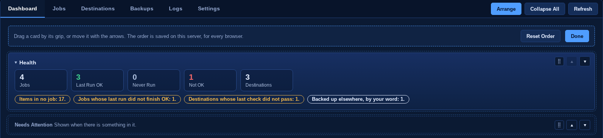

The Dashboard and Settings tabs have **Arrange** in the tab bar. It turns on
arrange mode: a bar at the top of the tab, and on each section a grip and
**Move Up** and **Move Down** arrows. Drag a section by its grip, or move it
with the arrows. Each move is saved at once on the server, in urbk.cfg, so
the order is the same in every browser; the bar says Order saved, or why it
could not be saved. **Reset Order** puts the tab back in its default order,
and **Done** ends arrange mode, as does leaving the tab.

A section that appears only when it has something to show keeps its place,
and in arrange mode it shows by its name so it can be moved too. On the
Settings tab, This Server and Tools urbk Uses move together as one row. A
section added in a later version of urbk appears after the section it
follows by default, so a saved order is never scrambled.

A line that says urbk is still at something, such as reading the server,
checking, or deleting, starts with a turning spinner, so slow work never
looks stuck.

## 2. The Dashboard

The Dashboard answers two questions: is everything on this server backed up,
and did the last runs work. Its sections, from the top unless you arranged
them, are Health, Needs Attention, Unprotected, Backed Up Elsewhere, Running
Now, Jobs, Destinations, Recent Activity and Queue. Needs Attention, Unprotected,
Backed Up Elsewhere, Running Now and Queue appear only when they have
something to show.

### Health


Five counts, then a row of short notes.

| Count | Means |
|---|---|
| **Jobs** | Jobs you have set up |
| **Last Run OK** | Jobs whose last run finished and backed up every item |
| **Never Run** | Jobs that have not run yet |
| **Not OK** | Jobs whose last run did not finish OK |
| **Destinations** | Destinations you have set up |

When urbk cannot read its run records, the run counts read **?** instead of a
number, since a count it cannot see is unknown, not zero.

The notes say what needs you, each with how many it concerns. Amber notes
are problems:

- **No jobs: nothing on this server is backed up.** and **No destinations:
  there is nowhere to back up to.**
- **No job runs on a schedule.**, or **Jobs that run only by hand: N.**
- **Items in no job: N.** These are listed under Unprotected.
- **Jobs whose last run did not finish OK: N.**, **Jobs never run: N.**
- **Jobs whose last verify did not pass: N.**, **Jobs overdue for a verify:
  N.**
- **Destinations whose last check did not pass: N.**, **Destinations whose
  last prune did not finish OK: N.**
- **Destinations with no check scheduled: N.**, **Destinations with no prune
  scheduled: N.**, **Destinations overdue for a check: N.**, **Destinations
  overdue for a prune: N.**
- **Run records or job and destination files that could not be read: N.**
- **Copies restores kept of what they replaced, which urbk never removes by
  itself: N. They are listed below; discard the ones you no longer need in
  Backups, Previous Copies.** A container, VM or stack restore moves the
  appdata, disk image or stack folder it replaces aside as
  `<name>.urbk-prev-<run>` rather than deleting it. Below the notes, each
  copy still there is listed by its path, with the item it was restored over
  and when. Discard the ones you no longer need under Backups, [Previous
  Copies](#previous-copies); the note goes once none is left. When urbk cannot read its list of them, the
  note reads **Which copies restores kept of what they replaced is unknown:**
  and the reason.

A grey note, **Backed up elsewhere, by your word: N.**, counts the items on
this server you have marked as backed up by something else (see Unprotected
below). It is
neither a warning nor an all-clear.

The green note appears only when there is nothing amber to say:

> **Every job runs on a schedule and last ran OK, every item is in a job, and
> every verify, check and prune is current and passed.**

When some items are marked as backed up elsewhere, it says "every item is in
a job or backed up elsewhere by your word" instead, so it never claims urbk
backs up something it does not.

### Needs Attention

What urbk could not read, and what is waiting for you, one line each:

- urbk's run records, or which tasks are running, could not be read: the
  line in red gives the reason.
- A job or destination file urbk refused, or a run record it could not read:
  each named by its file, with the reason. This is what the Health note
  **Run records or job and destination files that could not be read: N.**
  counts.
- A destination whose recovery sheet you have not confirmed yet: its name
  and **Sheet Not Confirmed**. Confirm it in the Destinations tab before the
  destination's first backup.
- A job whose first upload of a share is waiting for you to confirm its size,
  time and cost estimate: its name and **Estimate Not Confirmed**.

When urbk's status cannot be read at all, Needs Attention gives the reason,
and Running Now, Jobs, Destinations and Queue are hidden until it can be read
again.

### Unprotected

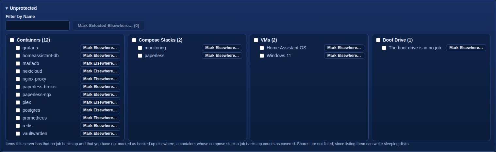

The containers, compose stacks and VMs no job backs up, and the boot drive
when no job holds it, one card per kind. Each card lists its items A to Z,
ignoring case, with numbers in number order. A container whose compose stack
a job backs up counts as covered and is not listed. Shares are not listed,
since listing them can wake sleeping disks.

**Filter by Name** narrows every card to the items whose name, or id, holds
what you type. Each card's heading then says how many of its items it shows, as in
**Containers (9 of 67)**, and **No item matches the filter.** shows when none
does.

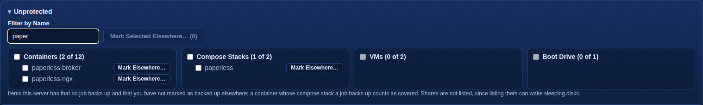

To say an item is backed up by something other than urbk, such as a VM your
own snapshot script copies:

1. Press **Mark Elsewhere…** beside it.
2. Under **Where It Is Backed Up**, write what backs it up and where the
   copies are, in one line, so you or someone after you can find them.
3. Press **Mark Backed Up Elsewhere**, or **Cancel** to leave it.

The form opens above the cards and warns that urbk will not back the item up
or check those backups: it leaves Unprotected on your word alone.

To mark several items at once, tick them, or tick a card's box beside its
heading to tick every item the filter shows in that card, then press **Mark
Selected Elsewhere… (N)**, where N is how many are ticked. One form names
them all and takes one line for all of them. urbk marks them all or none:
if any is refused, nothing is marked and the form says which and why. Ticks
stay while the page refreshes, and while you change the filter.

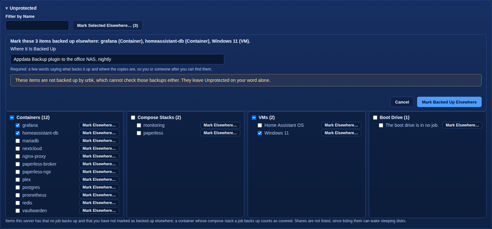

urbk refuses a mark on an item a job already backs up, on a container whose
compose stack a job backs up, and on any item while a job file cannot be
read, since whether a job holds it is then unknown. The line must be visible
text: a line break, a control character, or an invisible or right-to-left
override character is refused and named.

When the server's containers, stacks or VMs cannot be read, Unprotected says
which, rather than listing nothing. When the marks cannot be read, it lists
every item in no job and says the marks are unknown.

### Backed Up Elsewhere

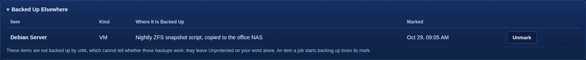

The items you marked, with **Item**, **Kind**, **Where It Is Backed Up** and
when each was **Marked**. **Unmark** puts an item back in Unprotected.

An item a job starts backing up loses its mark, since urbk now backs it up. A
marked item the server no longer has is still listed, by its id, and says it
is not on this server any more, until you unmark it.

### Running Now

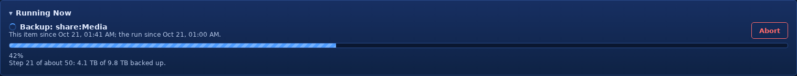

What urbk is doing this minute: the task, the item it is on, since when, and
for a long share backup the step it is on and how much it has backed up so
far. A spinner turns before the task, and the bar under it moves: once
restic gives a percent, stripes slide along the filled part, and before that
a block sweeps across it, so a scan with no percent yet never looks stalled. **Abort**, shown when the task belongs to a run, stops it at its next
safe point. Every step urbk takes that
changes the server is written to its journal first, so a container or VM it
had stopped for the backup is started again, and a restore cut short is put
back or finished.

### Jobs

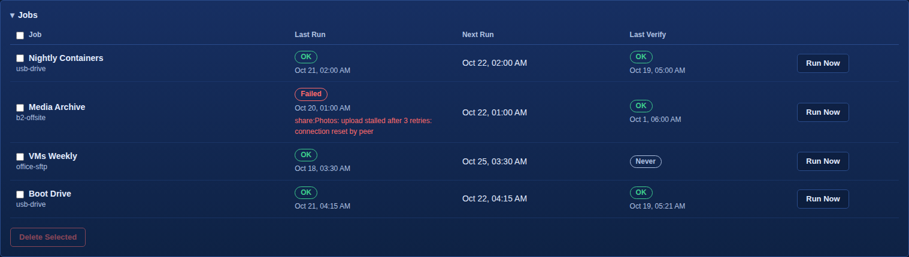

One row per job with its **Last Run**, **Next Run** and **Last Verify**. A
run that failed shows its error under it. A job that runs only by hand
shows **Not Scheduled** under Next Run. A job whose verify schedule has
fired twice since its last verify shows **Overdue** under Last Verify; hover
over it for why. **Run Now** starts the job at once.

Ticking jobs and pressing **Delete Selected** deletes those jobs. It asks
first, and their backups stay in their destinations' repositories: delete
backups from the Backups tab.

### Destinations

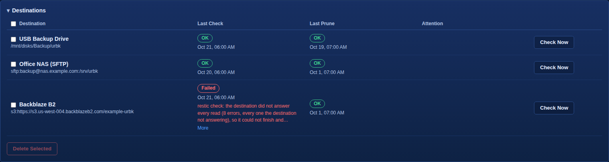

One row per destination with its **Last Check** and **Last Prune**, and an
**Attention** column that says **No Check Scheduled**, **No Prune Scheduled**,
**Check Overdue** or **Prune Overdue** when it applies. A check or prune that
is overdue also shows **Overdue** under Last Check or Last Prune. Hovering
over No Prune Scheduled says that forgotten backups free no space until a
prune runs; hovering over an overdue note says its schedule has fired twice
since it last ran. **Check Now** checks the destination's repository at once.

**Delete Selected** deletes the ticked destinations. Their repositories and
password files are kept, and a destination a job still uses is not deleted.

### Recent Activity

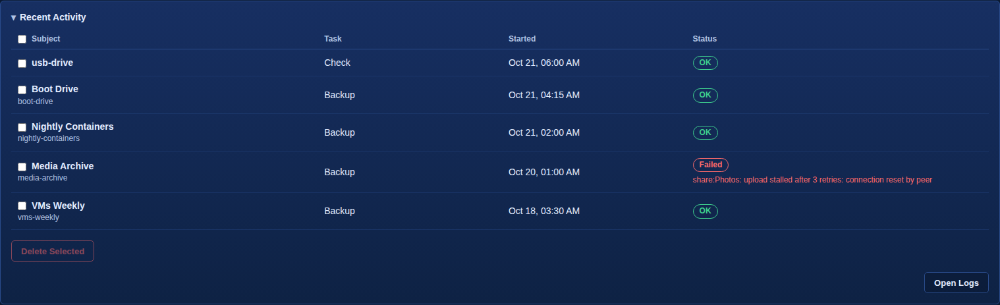

The five latest runs and tasks: **Subject**, **Task**, when it **Started**, and its
**Status**. A long error shows three lines and **More**, which opens the rest
in place and turns into **Less**. **Open Logs** goes to the Logs tab, which
has every record and its details.

**Delete Selected** deletes the ticked records. Only the log entries go;
every backup stays in its repository.

### Queue

Tasks waiting for urbk's lock while another runs, such as a scheduled check
that fired during a backup. Each runs in turn.

## 3. Jobs

A job says what to back up, where to, and when. The Jobs tab lists your jobs
on the left; picking one opens it in the editor beside the list, and **New
Job** opens an empty one.

### What a job backs up

**What It Backs Up** switches a job between **Server Items** and **Shares and
Folders**. A job backs up one or the other, never both, so a long backup of
shares never holds up the backups of the server itself. To switch a job that
already has items, clear every item first.

**Server Items** lists the server's **Containers**, **Compose Stacks**, **VMs**
and the **Boot Drive**, as urbk finds them; tick the ones the job backs up. A
container that belongs to a compose stack is greyed: the stack backs it up
whole, so pick the stack instead. Point at any greyed item to see why it
cannot be picked.

**Shares and Folders** lists the server's shares. Tick a whole share, or press
**Add a Folder** to back up only a folder inside one:

1. Under **Share**, pick the share.
2. Under **Folder**, open the folders inside it one level at a time. **Folder
   to Add** shows where you are, and **Up One Level** goes back.
3. Press **Add This Folder** to add the one shown, or **Cancel**.

**Left Out** says what the job skips in a share or folder; pick which one
under **Item**:

- **Always Left Out**: every urbk repository and urbk's state folder wherever
  the share holds one, a dataset's `.zfs` folder, and urbk's own staging
  folders, which are never backed up; and anything other items already back
  up, such as a container's appdata kept in the share.
- **Junk, Left Out by Default**: common cache and junk patterns, each shown
  as a chip, and folders marked as caches by a `CACHEDIR.TAG` file. Remove
  one to back it up after all. A share or folder you have just added gets
  these defaults when the job is saved, and can be changed after that.
- **Your Own Patterns for** the item: patterns of your own, one per line.
- **Restic Repositories To Back Up in** the item: a folder laid out as a
  restic repository, such as one another backup tool writes into the
  share, is left out unless you name it here, by its path inside the item,
  one per line (for example `os-restic`). Name one to keep an off-site copy
  of it; it is read live, so back it up while that tool is not writing to
  it. urbk's own repositories are never backed up, even when named, and
  the run's warning says so. A name that matches no repository shows as a
  warning on the run, and **Estimate
  Size** says which repositories are backed up and which are left out.

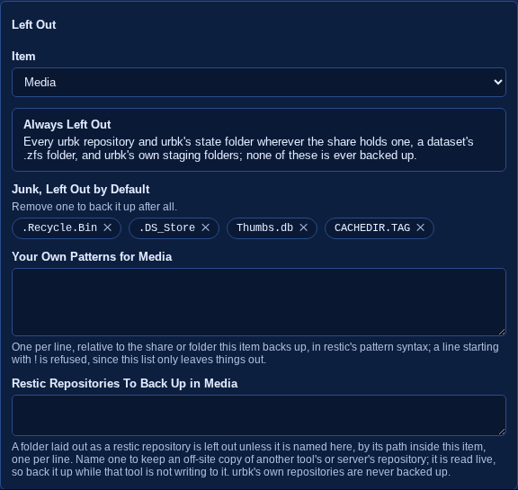

### The settings

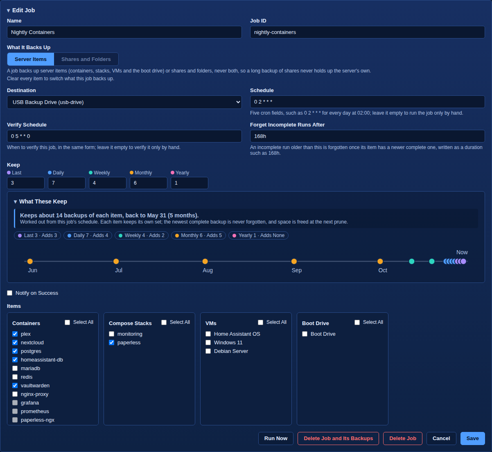

| Field | What it takes |
|---|---|
| **Name** | What the job is called on every page |
| **Job ID** | The job's id in urbk's files and commands. For a new job it follows the name; it cannot change once saved. |
| **Destination** | Where the job's backups go. A destination that no longer exists shows as **Not Found on This Server**. |
| **Schedule** | Five cron fields, such as `0 2 * * *` for every day at 02:00. Leave it empty to run the job only by hand. |
| **Verify Schedule** | When to verify this job, in the same form. Leave it empty to verify it only by hand. |
| **Forget Incomplete Runs After** | A duration such as `168h`. An incomplete run older than this is forgotten once its item has a newer complete one. |
| **Keep** | The keep rules (below) |
| **Notify on Success** | Send a notification when a run succeeds too. A failure always notifies. |

**Save** keeps the job; **Cancel** leaves it as it was. A new job whose id
another job already has is refused.

### Keep rules

**Keep** takes a number for each rule. Every backup that at least one rule
keeps stays; the rest are forgotten after each run.

| Rule | Keeps |
|---|---|
| **Last** | The newest N backups, whatever their dates |
| **Daily** | The newest backup of each of the last N days that had one |
| **Weekly** | The newest backup of each of the last N weeks, Monday to Sunday, that had one |
| **Monthly** | The newest backup of each of the last N months that had one |
| **Yearly** | The newest backup of each of the last N years that had one |

As you type, **What These Keep** works out what the rules hold on the job's
own schedule: how many backups of each item, how far back, and a timeline
whose dots name the rules that keep them.

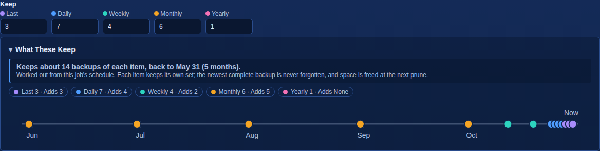

### The first upload of a share

Before the first upload of a share to a remote destination, urbk
works out its size and waits for you. The job shows **Estimate Not
Confirmed** on the Dashboard until you do:

1. Open the job and press **Estimate Size**. urbk reads each share or folder
   and says how many files and how much data it holds, its largest folders,
   and anything it left out.
2. Enter your **Upload Rate (Mbit/s)** and, if you like, the destination's
   **Price Per TB-Month** in your own currency; the panel works out the time
   and monthly cost.
3. Press **Confirm Estimate**. The first run may then start.

### Backing up another tool's restic repository

A share or folder can hold a restic repository that another tool writes,
for example a VM that backs itself up into a share. urbk leaves any such
repository out unless you name it, so its own repositories are never
backed up into themselves. To keep an off-site copy of it:

1. **Notice what was left out.** After a run, **Logs**, then the run, shows
   under the item, in amber, *the restic repository at ... holds no urbk
   marker and was left out*. **Browse…** on that backup shows the same in an
   amber box, and a folder that holds only the repository looks empty.
2. **Name it.** Open the job. In **Left Out**, pick the item under **Item**:
   the panel shows one item at a time, so pick the share or folder that
   holds the repository, not the first one listed. Type the repository's
   path inside that item in **Restic Repositories To Back Up in** the item,
   one per line, for example `os-restic`, and press **Save**.
3. **Check the size.** Before a job's first upload, **Estimate Size** now
   says the repository is **Backed up**, and counts it. For a job that has
   uploaded before, the button is not shown; `urbk estimate --job JOB` on
   the server prints the same.
4. **Keep the two tools apart.** urbk reads the repository live, file by
   file. If the other tool writes to it during the read, the copy can hold
   its newest snapshot without the data that snapshot needs; the next run
   fills that in. Set the job's **Schedule** so it reaches this item after
   the other tool has finished for the night. The times the repository's
   files were last changed show when that tool writes.
5. **Check the next run.** In **Logs**, the item shows no amber line about
   the repository, and **Browse…** lists it. If a warning says the name
   *lies in* a folder that stays out, or that *none is there*, the warning
   says why or quotes the name exactly as typed, so a stray space or a
   wrong folder shows.

Save from an editor you opened before the job was changed somewhere else,
such as from the command line, writes the editor's older copy back; close
the editor and open the job again first.

### Running and deleting a job

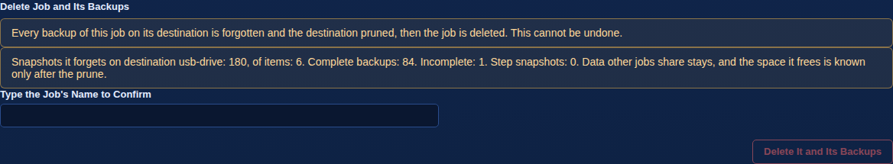

**Run Now** starts the job at once. **Delete Job** deletes only the job, after
asking: its backups stay in its destination's repository. **Delete Job and
Its Backups** deletes the job and every backup it made: it first shows what
would be deleted, then asks you to type the job's name under **Type the
Job's Name to Confirm** before **Delete It and Its Backups** does anything.

## 4. Destinations

A destination is where backups are kept: one restic repository, its
password, and how often it is checked and pruned. The Destinations tab lists
your destinations; picking one opens it in the editor beside the list, and
**New Destination** opens an empty one.

### Kinds of destination

**Type**, chosen when the destination is made, is one of:

| Type | Where the repository is |
|---|---|
| **Local Folder** | A folder on a pool, a share or an external drive of this server |
| **SFTP Server** | A folder on another machine, reached over SFTP with a key urbk makes |
| **Amazon S3** | A bucket in Amazon S3 |
| **Backblaze B2** | A Backblaze B2 bucket |
| **Other S3-Compatible** | A bucket on any S3-compatible service, Google Cloud Storage included |
| **SMB Share** | A share on another machine, which urbk mounts only while it uses it |
| **NFS Export** | An NFS export on another machine, mounted the same way |
| **OneDrive or Google Drive (rclone)** | A folder on a cloud drive, through urbk's own copy of rclone |

Each type asks for where the repository is:

- **Local Folder**: a folder picked from this server's storage, or typed
  under **Repository**.
- **SFTP Server**: **Host**, **Port**, **User** and **Path**.
- **Amazon S3**, **Backblaze B2** and **Other S3-Compatible**: a **Region** or
  **Endpoint**, **Bucket**, **Prefix**, **Access Key ID** and **Secret Access
  Key**.
- **SMB Share**: **Host**, **Share**, **Path**, **User Name**, **Password**
  and **Domain**.
- **NFS Export**: **Host** and **Export Path**.
- **OneDrive or Google Drive (rclone)**: **Remote**, **Folder** and **Rclone
  Config**.

Keys and passwords are kept in urbk's secrets folder on the boot drive,
readable by root only on this server, and never shown again. urbk's own
boot drive backups leave that folder out, but any other copy of the boot
drive, such as Unraid's flash backup download, also carries them. A boot
drive exported over SMB serves them to the network, and so does an export
of Yes (hidden): set its SMB Export to No under Main, Boot Device. A Health
note on the Dashboard warns while it is exported. Once a
destination is made, its **Repository** is
shown but cannot be changed: give a new repository its own destination.

An **SFTP Server** needs two steps before the destination can be made:

1. **Prepare Key** makes a key for this destination and shows one line. Add
   it to the authorized_keys file of that user on the server; it lets urbk
   use SFTP there and nothing else.
2. **Scan Host Keys** reads the server's host keys. **Pin** the one whose
   fingerprint matches what `ssh-keygen -lf` shows for the server's own host
   key file, and nothing if none matches. urbk then refuses the server if its
   key ever changes.

For **OneDrive or Google Drive (rclone)**: on a computer with a browser, run
`rclone config` and add a remote for the drive, signing in when asked, then
run `rclone config show` with the remote's name and paste what it prints under **Rclone Config**.
**Connect Drive** lists the drive's folders under **Folders On The Drive**;
pick one, or a new folder and type its name in **Folder**. Google Drive needs
your own OAuth client ID, and takes about 750 GB a day per account, so a
first backup can take days. Cloud drives throttle heavy traffic, so they suit
small items such as the boot drive, appdata and VM definitions rather than
large shares.

The editor also says what each kind needs to work:
- A Local Folder on a pool or user share is lost with this server, so it
  cannot recover a lost boot drive; an external drive or a remote
  destination can.
- An NFS export must be exported with `no_root_squash`, to this server's
  address only: urbk writes as root, and an export that maps root to
  another user is refused.
- An S3 bucket must keep no old versions and leave Object Lock off, or
  pruning frees nothing; a server with a private certificate authority
  needs its certificate at `secrets/ID/s3_ca.pem` on the boot drive.

### The other settings

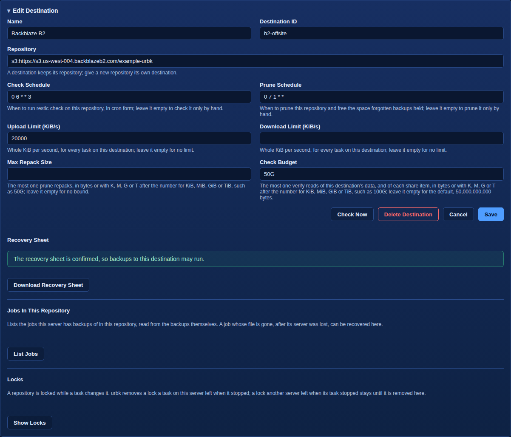

| Field | What it takes |
|---|---|
| **Name** | What the destination is called on every page |
| **Destination ID** | Its id in urbk's files and commands |
| **Check Schedule** | When to run restic check on the repository, in cron form. Empty checks it only by hand. |
| **Prune Schedule** | When to prune the repository and free the space forgotten backups held. Empty prunes it only by hand. |
| **Upload Limit (KiB/s)**, **Download Limit (KiB/s)** | Whole KiB per second, for every task on this destination. Empty is no limit. |
| **Max Repack Size** | The most one prune repacks, such as `50G`. Empty is no bound. |
| **Check Budget** | The most one verify reads of this destination's data, and of each share item, such as `100G` (G is GiB). Empty is the default, 50,000,000,000 bytes. |

### Creating it, and the recovery sheet

**Create** makes a new password for the destination and its repository; for
a remote repository this can take a few minutes. When a repository is
already at that location, urbk says so instead and offers **Use the Existing
Repository**: type the **Password from the Recovery Sheet** of that
repository, and urbk opens it before anything is saved, so a wrong password
changes nothing. **Pick Another Folder** goes back to choose somewhere else.
When a destination deleted with the same id left its password behind, no
password is asked for: **The password of a destination deleted with this id
was kept, so the repository can be opened without typing one.**

A new destination's password exists only on this server until you keep it
somewhere else. Under **Recovery Sheet**:

1. **Download Recovery Sheet**. It holds the destination's location and
   password, and this server's ID, which a replacement server adopts.
2. Keep it somewhere other than this server.
3. Type its password back under **Password from the Recovery Sheet** and
   press **Confirm**.

Backups to the destination wait until then: each scheduled run of a job
that uses it is refused and sends an alert that it could not run, every
time, until the sheet is confirmed. Until then the Dashboard's Needs
Attention, and the destination's row in the Destinations list, say **Sheet
Not Confirmed**.

### Checking a destination

**Check Now** runs restic check on the repository at once, and the editor
shows how it went. It is greyed while the editor holds unsaved changes:
**Save the destination first: a check runs its saved settings, not these
edits.** A check reads the repository's structure; a verify, set per job,
reads the backups' data back.

### Jobs In This Repository

**List Jobs** reads the backups in the repository and lists the jobs this
server has backups of there, read from the backups themselves. A job whose
file is gone, after its server was lost, shows **Recover Job**, which writes
the job's file back. When the repository also holds backups of another
server, it says so: if this server replaces that one, adopt its server ID in
Settings, Server Recovery, and list the jobs again.

### Locks

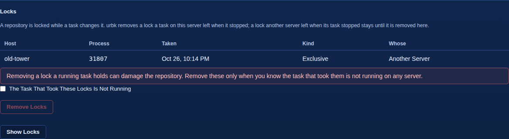

A repository is locked while a task changes it. urbk removes a lock that a
task on this server left when it stopped. A lock another server left stays
until it is removed here.

**Show Locks** lists each lock with the host and process that took it, when,
its kind, and whether it is this server's. Removing a lock a running task
holds can damage the repository, so **Remove Locks** works only once you tick
**The Task That Took These Locks Is Not Running**, and is refused while a
task on this server still holds the repository, or when whose the locks are
is unknown. A lock taken in the last 30 minutes is said to be possibly still
running.

### Deleting a destination

**Delete Destination** deletes the destination after asking. Its repository
and password file are kept, and a job that uses it must be changed first. A
destination that was prepared but never created, such as an SFTP key made
before **Create**, is listed under **Prepared, Not Created**, where
**Delete** removes its stored credentials or key; no repository is touched.

## 5. Backups

The Backups tab lists every backup urbk can restore, and restores it. Pick a
job under **Jobs** on the left, and its backups appear under **Restore
Points**; a backup picked there opens beside the list.

### Finding a backup

**By Item** lists the job's items A to Z, each with its backups newest first:
when each was taken and the first eight characters of its run. **By Run**
lists the job's backup runs instead, newest first, to restore several items
of one run at once.

**Filter by Name** narrows the list to the items whose name or id holds what
you type, and, for a job holding several kinds, **Show** picks one kind:
**Everything**, **Containers**, **Compose Stacks**, **VMs**, **Boot Drive**
or **Shares**. **No item matches the filter.** shows when none does.

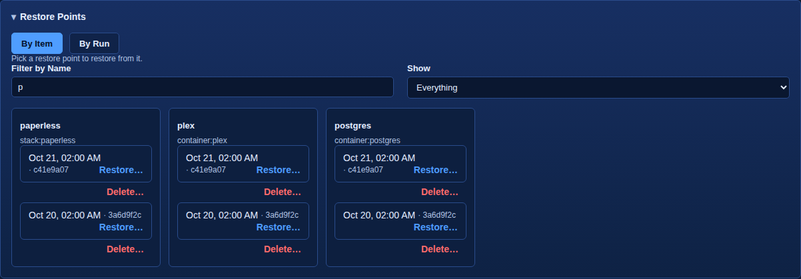

Each backup is a button ending in **Restore…**; click it to restore. Beside
each backup are:

- **Browse…** for a share or the boot drive, to look through its files;
- **Stage Disk…** for a VM, to stage one of its disks as an image;
- **Delete…** to delete that backup.

When another task holds the repository, Restore Points says so instead of
listing it, and reads the list again by itself every 20 seconds until it
can.

### Picking where

Wherever urbk writes a restore or a staged copy, **Location** picks a place on
this server, such as a pool, a user share, an external drive or an array
disk, depending on what is being restored, or **Other (Type a Path)** to type
one. **Folder** then picks a folder already there or **The Location Itself**.
A share restore into a folder cannot pick a pool (**The mover could move
files of a restore written to a pool while it runs, so pick the share under
User Shares.**), and staging cannot pick a pool or an array disk itself,
only a folder inside it. What urbk writes always goes into a new folder of
its own there, and nothing already there is touched.

### Restoring a container, stack or VM

Clicking a backup opens **Restore This Backup**, which names the item and
when the backup was taken, and says what the restore does:

- A container: **The container is stopped and its appdata is swapped for the
  backup's; the live appdata is kept beside it, and a removed container is
  recreated from its template.**
- A compose stack: **The stack's services are stopped and its folder and
  pieces are swapped for the backup's; the live ones are kept beside them.**
- A VM: **The VM is shut down and its disks, NVRAM and TPM state are swapped
  for the backup's; the live ones are kept beside them.**

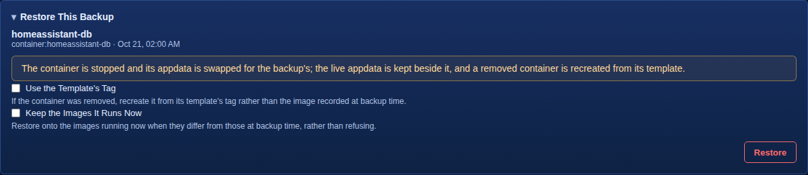

A container restore also offers two choices, and a stack restore only the
second:

- **Use the Template's Tag**: if the container was removed, recreate it from
  its template's tag rather than the image recorded at backup time.
- **Keep the Images It Runs Now**: restore onto the images running now when
  they differ from those at backup time, rather than refusing.

**Restore** asks once more, naming the item and the backup, and starts it.
The panel follows the restore until it ends and says how it went: for a
restore into a folder, **The files are in** and the folder, then any note,
**The restore ended with these warnings.** with each warning, and **The
restore left these out, each with why.** with each one. What the restore
kept beside the item is listed under [Previous
Copies](#previous-copies) until you discard it.

When a task holds urbk's lock, Restore is greyed and the panel names the
task; when it belongs to a run, **Abort the Running Task** stops it first.

### Restoring several items of one run

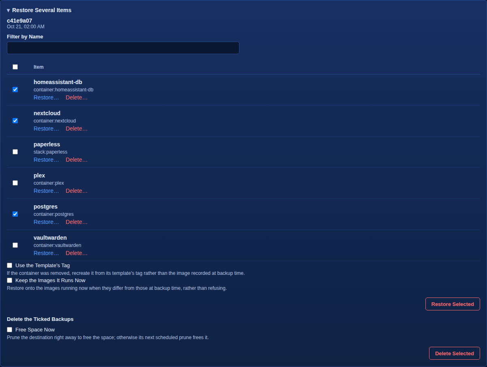

In **By Run**, pick a run. **Restore Several Items** lists its items with a
box each, a **Filter by Name**, and a box in the heading that ticks every
container, stack and VM shown. Tick two or more of them and press **Restore
Selected**. Every item also has its own **Restore…** in the list; the boot
drive and shares can only be restored that way. Each ticked item is
stopped, replaced from the backup and started again, one after another, and
the restore stops at the first that fails. One batch takes at most 500
items: past that, this list's **Restore Selected** and **Delete Selected**
say **One batch takes at most 500 items; untick some.**

When the run holds a container or stack, two choices apply to the whole
restore: **Use the Template's Tag** and **Keep the Images It Runs Now**. Both
are offered even when the run holds only stacks.

### Restoring files from a share

Clicking a share's backup opens **Restore Files**:

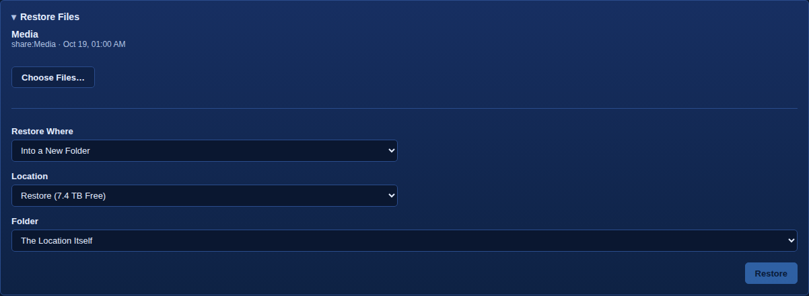

1. **Choose Files…** lists what the backup holds. Open folders by name, page
   through long folders with **Next Page** and **Previous Page**, and tick
   the files and folders to restore. The ticked ones show as chips; pressing a
   chip unticks it.
2. Under **Restore Where**, pick one:
   - **Into a New Folder**: pick where. **Restore** asks once more and
     starts it.
   - **Over the Live Share**: this writes over the live share, and nothing it
     writes over can be put back, so urbk asks for three things first. Press
     **Preview**, which says how many entries the restore would write over
     and how much it would write. Then type the share's name under **Type the
     Share Name** and that count under **Type the Count of Entries to Write
     Over**. **Restore Over the Live Share** works only then, and only while
     the ticked files are still the ones you previewed.

Restoring into a new folder first is the safe way.

A share can hold the same file on more than one pool or disk, for example
when Unraid's mover stopped halfway. urbk takes the copy on the share's
primary pool, then the other pools by name, then the array disks by number,
the order Unraid reads a share's pools in. A restore keeps that copy, and
the restore says so, as in **p/x was on data and vms; of each file there on
more than one, the copy from vms, restored last, was kept**, under **The
restore ended with these warnings.**; in Logs it is in the record's **What
urbk Printed**. A backup records the share's primary pool, and warns when it
cannot read it; the restore then takes the pools by name. Where that decided
between copies on two pools or more, as with a backup from before urbk
recorded the primary pool, the restore says so: **which pool Unraid looks in
first for this share was not recorded when it was backed up, so of a file on
more than one pool the copy kept goes by pool name and may not be the one the
share showed**. A restore over the live share shows that with its **Preview**,
before you confirm it. A pool beating an array disk is no guess, so a copy
on one pool and a disk does not say this.

### Looking through a backup

**Browse…** on a share or the boot drive opens **Browse This Backup**: what
the backup holds, as it was backed up, read only. Nothing is restored from
there; its **Restore…** starts a restore of that backup. When the run that
made the backup recorded warnings for the item, an amber box above the
listing names them, so a folder that looks empty because a repository in it
was left out says so. The same box shows on a share's **Restore…** and on
**Choose Files…**.

A file the backup holds on more than one pool or disk shows once, as the
copy the share shows, with a marker beside its name. Hovering the marker says
where the others are, as in **Another copy is on data, hidden by the
share.**

### Restoring the boot drive

The live boot drive is never written: **The boot drive is staged in a folder
of its own, ready to copy to a new drive; the live boot drive is never
written. Onto a server that is already running, do not copy config/super.dat,
config/pools or the config/*.key files: they hold the lost server's drive
assignments and license.** Clicking a boot drive backup asks where to stage
it, under **Stage the Boot Drive In**, somewhere with room for it. Then
either:

- **Restore** stages the whole boot drive; or
- under **Choose Files to Stage**, **Choose Files…** lists the backup's files.
  Tick the ones you want and press **Stage Chosen Files** to stage only
  those.

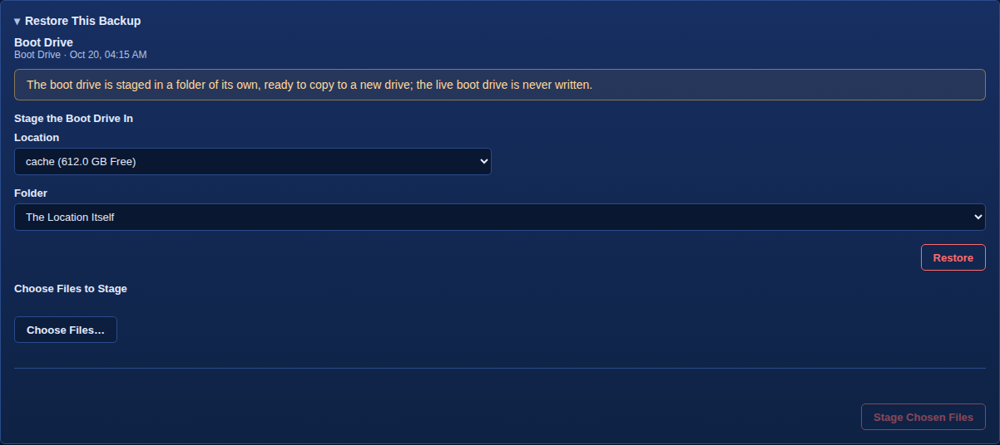

### Staging a VM disk

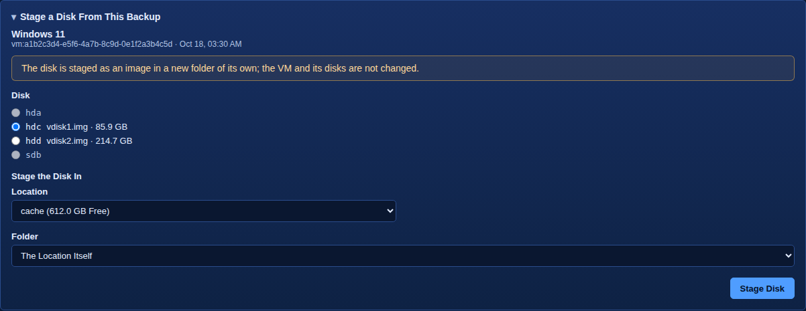

**Stage Disk…** on a VM backup opens **Stage a Disk From This Backup**. The
disk is staged as an image in a new folder of its own; the VM and its disks
are not changed. Pick the **Disk**; a disk that cannot be staged is greyed,
and says why when you point at it. Pick where under **Stage the Disk In**:
somewhere with room for the image on a pool, an external drive or one array
disk, not a user share. Then press **Stage Disk**.

### Deleting backups

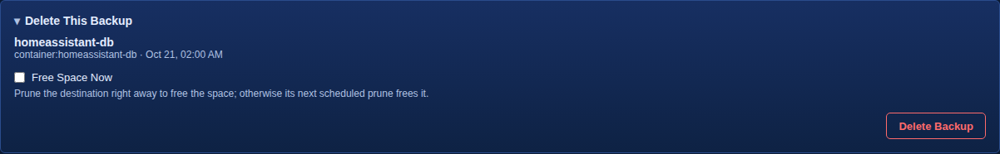

**Delete…** beside a backup opens **Delete This Backup**. **Delete Backup**
asks once more and deletes it, and when it is the item's only backup, asks
you to type the item's name too.

In **By Run**, tick several items of the run and press **Delete Selected**,
under **Delete the Ticked Backups**. urbk lists them, says which are an
item's newest or only backup, and asks you to type how many there are.

Either way, **Free Space Now** prunes the destination right away to free the
space; otherwise its next scheduled prune frees it.

### Recent Restores

The latest 50 restores and stages, with the **Item**, when each **Started**
and its **Status**. A restore of several items of one run is listed in Logs,
as **Batch Restore**, not here. **Delete Selected** deletes the ticked
records; the backups stay.

### Previous Copies

Each copy a container, VM or stack restore kept of what it replaced
(`<name>.urbk-prev-<run>`), with the **Copy**'s path, the **Item** it was
restored over, when it was **Kept** and its **Size**. urbk never removes one
by itself. A size urbk cannot read shows as unknown, with why on hover.

Every copy a restore noted is listed, including one urbk can no longer find,
for example after it was removed by hand. Such a copy shows **Missing** in
place of its size, with a **Forget** button in place of Discard. A copy
whether it is there is unknown, as on a pool zfs cannot list, shows
**Unknown** with why on hover, and has neither button.

**Discard** asks first, **Discard /mnt/.../app.urbk-prev-...? It is the copy
a restore kept of what it replaced, and once it is gone it cannot be brought
back.**, then removes it. urbk refuses, saying why, a copy a process or a
container still has open or mounted, one with a mount inside it, one whose
use it cannot read in time, and anything a restore did not keep; the copy
stays listed and Discard can be pressed again.

**Forget** asks first, **Forget /mnt/.../app.urbk-prev-...? urbk can no longer
find it, so only its line in this list goes; nothing on disk is touched.**,
then drops the copy's line from the list. urbk refuses, saying why, a copy
that is there again or whose state it cannot read; the copy stays listed
and Forget can be pressed again. With none left, the section reads **No
restore has kept a copy of what it replaced.**

## 6. Logs

The Logs tab lists what urbk has done: every backup run, check, prune,
verify, boot test, restore and delete. Picking one shows its detail
beside the list.

### Runs

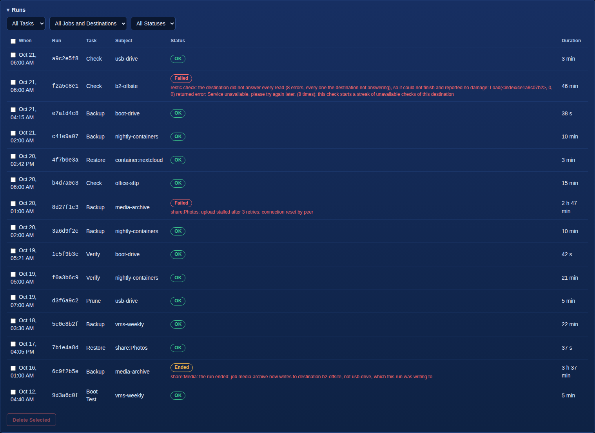

**Runs** has one row per record: **When** it started, the first eight
characters of its **Run** id, its **Task** (**Backup**, **Check**,
**Prune**, **Verify**, **Boot Test**, **Restore**, **Batch Restore**,
**Delete Backup** or **Delete Backups**), its **Subject**, its **Status**,
and how long it took under **Duration**. A failure shows its error under the
status, three lines with **More** when it is long.

Three lists above the table narrow it: **All Tasks**, **All Jobs and
Destinations** and **All Statuses** each pick one task, subject or status
from those in the list. Clicking a column's heading sorts the table by it,
and clicking it again reverses the order.

Only the newest 200 runs are listed, and a note below the table says so
when there are more; `urbk runs --limit 1000` on the server lists up to
1000. A record urbk cannot read is named above the table, with why.

Ticking records and pressing **Delete Selected** deletes them after asking.
Only those log entries go; every backup stays in its repository.

### Run Detail

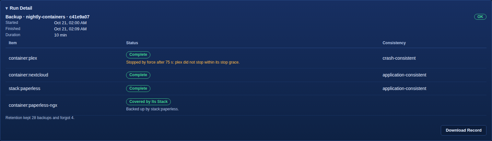

Clicking a row, or pressing Enter on it, opens **Run Detail**: the task, the
job or subject and the run id, its status, when it **Started** and
**Finished**, and its **Duration**. When it failed, its error is shown in
full. A failure urbk refused for a known reason, such as a claim on the
destination, reads as a short sentence instead, with urbk's whole message
when you point at it.

A run that waited for a repository lock says so in amber, once per wait:
*Waited 2 min for the repository lock (forget), held by ...*, naming the
restic command that waited and who held the lock.

For a backup run, a table lists each **Item**, its **Status** and its
**Consistency**. Under an item's status:

- **Backed up by** names the compose stack that covers a container listed
  with it;
- a line such as *Stopped by force after 60 s: plex did not stop within its
  stop grace.* names a service Docker killed when its stop grace ran out, so
  that backup of it is crash-consistent; point at it for why, and what to
  change if the service ignores its stop signal;
- in amber, each warning the item was kept despite, such as a restic
  repository in the share left out, files that could not be read, the mover
  starting during the read, a repository the item's options name that stays
  out and why, a container's folder in the share whose own item no job
  holds, so it was read live, or a step that takes longer than the shortest
  gap between this server's scheduled tasks. The first five are shown, then how many more **Download Record**
  holds. An item can read **Complete**, and the run **OK**, while a warning
  says something was left out, so read them;
- an item that failed, or that a stop interrupted, shows its error.

Below the table, in amber, is anything the run itself had to say, such as
an unmount of the destination's share that had to be forced. Then it says
what retention did: how many backups it kept and
how many it forgot, or that retention was not run and why, so no backups
were forgotten, or that it failed after the backups.

For every other task, **What urbk Printed** shows what urbk recorded it
printing.

For every task, **Download Record** saves the whole record as one `.json`
file.

## 7. Settings

The Settings tab says what urbk is running on and with, and holds the few
settings urbk has, and Server Recovery.

### This Server

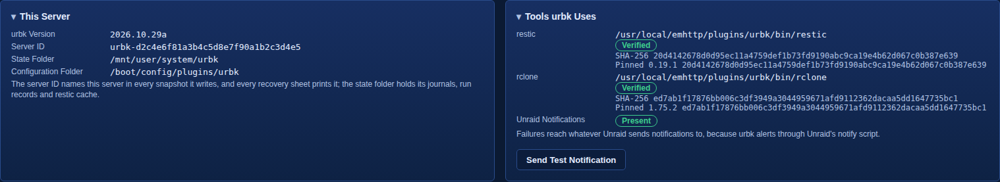

- **urbk Version**: the version installed.
- **Server ID**: the id that names this server in every snapshot it writes
  and that every recovery sheet prints.
- **State Folder**: where urbk keeps its journals, run records and restic
  cache.
- **Configuration Folder**: where its jobs, destinations and settings are.

A value urbk could not read shows why, in red, rather than a guess.

### Tools urbk Uses

**restic** and **rclone** each show the file urbk runs, whether it is
**Verified**, its **SHA-256**, and the version and SHA-256 urbk is
**Pinned** to. A tool that is not the pinned build reads **Not Verified**,
with the reason.

**Unraid Notifications** says whether Unraid's notify script is **Present**
or **Missing**. urbk's failure alerts go through it, so they reach whatever
Unraid sends notifications to. **Send Test Notification** sends a test alert
at the importance urbk's failure alerts use; if it does not arrive, Unraid's
Settings > Notification Settings chooses where alerts go.

### Top Menu

**Show In Top Menu** puts Backups on Unraid's top bar, after Docker, in
place of urbk Backup under Settings > User Utilities. The page moves there
as soon as the box is changed.

### Default Stage Folder

Where the boot drive and Stage Disk start their folder pickers; each stage
can still pick another folder. Pick a place and a folder inside it, then
**Save Default**; **Clear Default** goes back to starting at the first place
listed. Save Default stays greyed, and says why when you point at it, until
a place from the list is picked and, on a pool or disk, a folder inside it.
A default in a user share is used by the boot drive only, since Stage Disk
never stages in a user share.

### Server Recovery

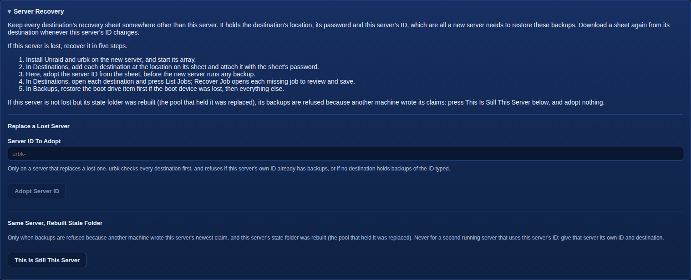

What to keep for a lost server, and the five steps to recover it, as the
section lists them:

1. Install Unraid and urbk on the new server, and start its array.
2. In Destinations, add each destination at the location on its sheet and
   attach it with the sheet's password.
3. Here, adopt the server ID from the sheet, before the new server runs any
   backup.
4. In Destinations, open each destination and press List Jobs; Recover Job
   opens each missing job to review and save.
5. In Backups, restore the boot drive item first if the boot device was
   lost, then everything else.

**Replace a Lost Server** takes the **Server ID To Adopt** from the recovery
sheet. **Adopt Server ID** stays greyed until a whole id is typed, and says
on hover how many of its 32 characters are typed so far. Pressing it checks
every destination for that id's backups and claims, which for a remote
repository can take a few minutes, then asks whether to make it this
server's id, saying when, on which destination and, when known, by which
machine the id was last claimed, or that no destination holds a claim of it.
**Adopt** makes it so; **Cancel** leaves it. urbk refuses when this server's
own id already has backups, or when no destination holds backups of the id
typed. Once adopted, download each destination's recovery
sheet again.

**Same Server, Rebuilt State Folder** is for a server that is not lost, but
whose state folder was rebuilt because the pool that held it was replaced:
its backups are then refused because another machine wrote its claims.
**This Is Still This Server** asks to confirm, and **Confirm** makes its next
backups take its claims back. Never use it for a second running server that
uses this server's id.

### Help

**README** opens urbk's public page, with what urbk backs up and restores,
how it works, and screenshots of every tab. **Download Diagnostics** saves
one `.json` file for a bug report: urbk's version, folders, restic check and
notify setting, and the settings urbk writes. It holds no repository, job,
destination or secret; read it before you post it.

## 8. Recovering a Server

Everything a new server needs to restore a lost one's backups is on each
destination's recovery sheet: the destination's location, its password and
the lost server's ID. Keep every sheet somewhere other than the server (see
Creating it, and the recovery sheet, in chapter 4).

Settings, **Server Recovery**, lists the five steps below.

### 1. Install Unraid and urbk, and start the array

Install Unraid on the new boot drive, install urbk (Installing, updating
and removing, in chapter 1), and start the array,
creating the array and pools first if the disks are new.

With the same disks, every drive must go back into its old slot before the
array is first started: a data disk assigned to a parity slot is overwritten
by the parity sync that follows. urbk cannot help before the array is
started, and the recovery sheet does not record the slots. The safe way is
Unraid's own: before the new boot drive's first boot, restore the backup's
`/boot/config` onto it from another computer with restic and the recovery
sheet's password, so Unraid starts with the old assignments. A boot drive
backup is read while the server runs, so its disk assignments may be from a
moment before the last change. Its `config/*.key` is the old drive's
license, which is not valid on the new one: keep the new drive's own key, or
do Unraid's license transfer, before starting the array.

On the other computer, restic needs the **Repository**, **Password** and
**Server ID** from the destination's recovery sheet (for a remote
destination, also that service's own access keys, which the sheet does not
hold). The boot drive's backups are that server's snapshots tagged
`urbk-item=666c617368` (urbk writes item names in hex; this is `flash`) and
`urbk-piece=files`. This restores the newest one's `config` folder, leaving
out the old license key:

```
export RESTIC_REPOSITORY='<the sheet's Repository>'
export RESTIC_PASSWORD='<the sheet's Password>'
restic restore 'latest:/boot/config' --host '<the sheet's Server ID>' \
  --tag urbk-item=666c617368,urbk-piece=files \
  --target /tmp/config --exclude '/*.key'
```

Then copy what is in `/tmp/config` into the new boot drive's `config`
folder; the new drive's own key stays. `latest` is the newest snapshot that
matches the host and tags; `restic snapshots` with the same `--host` and
`--tag` lists them all, and an older one's ID can take the place of
`latest`.

With the same disks and that `/boot/config` in place, urbk finds its own
state folder on the pool again, with the lost server's ID in it: it is the
same server, and step 3 is not needed.

### 2. Attach each destination

In **Destinations**, add each destination at the location on its sheet.
urbk finds the repository already there and offers **Use the Existing
Repository**: type the **Password from the Recovery Sheet**. The repository
is opened with it before anything is saved; a wrong password changes
nothing. Once attached, urbk says how many backups the repository holds.

With the backup's `/boot/config` in place (step 1, same disks), the
destinations and jobs are already there, but not their passwords: urbk's
boot drive backups leave out its secrets folder. Each destination is listed
in **Destinations** as **Password Missing**, its jobs are left out of
**Jobs**, and the Dashboard lists each one urbk refuses. Open each
destination: under its settings, below **Save**, it says its password file
is missing and asks for the **Password from the Recovery Sheet**. A remote
destination also asks for the credentials it lacks, which the sheet does not
hold: **User Name**, **Password** and **Domain** for SMB, **Access Key ID**
and **Secret Access Key** for S3, the **Rclone Config** for rclone; for
SFTP, press **Prepare Key**, add the line it shows to the server's
`authorized_keys`, then **Scan Host Keys** and **Pin** the server's key, as
when it was created. Type the password and press **Use the Existing
Repository**: the credentials are saved for that destination's own location,
then the repository is opened with the password before it is kept, and a
wrong password changes nothing. Its jobs return to **Jobs** once it is
attached.

Type the password by hand, or paste it from the sheet into an empty field:
a password the browser fills in on its own is not the sheet's.

### 3. Adopt the server ID

Under Settings, **Server Recovery**, **Replace a Lost Server**, type the
**Server ID To Adopt** from the sheet and press **Adopt Server ID**, before
the new server runs any backup. urbk checks every destination for that ID's
backups and claims, which for a remote repository can take a few minutes,
then asks once more, saying when, on which destination and, when known, by
which machine the ID was last claimed. If that server is still running,
stop: two running servers with one ID write over each other's backups.
urbk refuses when this server's own ID already has backups, or when no
destination holds backups of the ID typed. Once adopted, download each
destination's recovery sheet again.

**This Is Still This Server** is for another case: the server is not lost,
but its state folder was rebuilt (the pool that held it was replaced), and
its backups are refused because another machine wrote its claims.

### 4. Recover the jobs

In **Destinations**, open each destination and press **List Jobs**. It lists
the jobs this server has backups of there, read from the backups themselves
(Jobs In This Repository, in chapter 4). **Recover Job** opens each one whose
file is missing, to review and save.

### 5. Restore

In **Backups**, restore the boot drive first if the boot device was lost
(Restoring the boot drive, in chapter 5), then shared pieces, then
containers, stacks and VMs, so nothing starts against a shared folder that
is not back yet. A target whose original pool or share is gone is refused
until it exists again.

The boot drive is staged into a folder for you to copy from by hand. Onto a
server that is already running, do not copy `config/super.dat`,
`config/pools` or the `config/*.key` files: they hold the lost server's drive
assignments and license. Leave out urbk's own folder,
`config/plugins/urbk`, too: it holds the destinations, jobs and secrets you
have just set up.

## 9. The Command Line

The urbk page runs these commands for you; the command line is for scripts
and for looking closer. The program is
`/usr/local/emhttp/plugins/urbk/bin/urbk`, which is not on the path, and it
runs as root. With no command, or a command used wrongly, it prints its full
usage: every command with its flags and what each does. Most print their
result as JSON.

### Looking

| Command | What it does |
|---|---|
| `discover` | Prints the containers, compose stacks, VMs and flash configuration this server has; with `--shares`, also its user shares, which can wake a sleeping disk. Its `schema_version` goes up only when an older reader could not handle the output. |
| `storage` | Prints the places urbk can write to now: each pool, user share, external drive and array disk, with its free and total bytes; with `--folders`, the folders in one of those places or in a folder of a share item. |
| `estimate` | Estimates what each share item of a job would read, metadata only, writing nothing. |
| `info` | Prints what urbk uses on this server: its version, folders, this server's ID and the restic it runs. |
| `status` | Prints what urbk has done and will do next: each job's schedules, next fires and newest run, verify and boot test, each destination's newest check and prune and whether its recovery sheet is confirmed, who holds urbk's lock and which tasks are queued or running, the copies restores kept, and whether the flash drive, which holds urbk's secrets, is shared over SMB. It never takes a lock, and what it cannot read it says is unknown. |
| `runs` | Prints the recorded runs, newest first: 100 by default, up to 1000 with `--limit`, narrowed with `--job`, `--destination` or `--kind`; with `--run`, one run's full record. `runs delete` removes run records, never a backup. |
| `browse` | Lists one folder of a share item's backup, a page at a time. |
| `keep-preview` | Prints what keep rules hold for one item once a schedule has run long enough to fill every rule. |
| `version` | Prints the urbk version. |

### Backing up and checking

| Command | What it does |
|---|---|
| `run-job` | Runs a job from urbk's configuration, as its schedule and **Run Now** do. |
| `backup` | Backs up one container, VM, compose stack, share item or the boot drive to a repository. |
| `verify` | Verifies a job, bounded: reads one part of its repository's data back, in rotation, then restores one of its items' newest backups into a scratch folder, or samples a share item, within the destination's **Check Budget**. |
| `boot-test` | Boot-tests a VM's newest complete backup on demand. |
| `check` | Runs restic check on a destination's repository metadata, under urbk's lock, and alerts through Unraid's notify when it fails. |
| `prune` | Removes the data no backup uses any more from a destination's repository, under urbk's lock, and alerts when it fails. It first forgets the step snapshots of share reads no job on the destination holds any more, once they are 7 days old. |
| `forget` | Applies a job's keep rules to each item's backups in a repository. |
| `forget-point` | Deletes chosen backups by hand. |

### Restoring and recovering

| Command | What it does |
|---|---|
| `restore` | Restores a container, VM, compose stack, share item or the boot drive, one at a time or several of one run as a batch. `--list` prints a job's complete backups, newest first. A share item restores into a new folder with `--to`, or over the live share with `--live`: `--preview` first counts what it would write over and gives a token the restore must quote back, and what it writes over cannot be put back. A restore prints what it could not do cleanly under `warnings`. |
| `kept` | Lists every copy restores kept of what they replaced, each with its state (there, missing, or unknown with why) and, when there, the space it takes. `--discard PATH` removes one, refusing a copy a process has open or mounted; `--forget PATH` drops a missing one from the list, touching nothing on disk. |
| `adopt-server-id` | Makes a lost server's ID this server's, on a server that replaces it. |
| `confirm-identity` | Says this machine is still the server its ID names, only when its state folder was rebuilt. |
| `release-claim` | Releases a server's claim on a destination's repository, so this server may write to it again. |
| `replay` | Undoes what runs that died left half done, such as a stopped container or a half-swapped restore. |
| `abort` | Stops the urbk holding the lock for a run, a run waiting for it, or a task waiting in the queue. |

### Configuring

| Command | What it does |
|---|---|
| `job` | `save` saves a job read as JSON once it passes every check a run makes of it; `show` prints one; `delete` deletes one, and with `--with-backups` also deletes its backups; `confirm-estimate` records the size estimate a share job's first run to a remote destination waits for. |
| `destination` | `create` makes a destination and its repository, and `attach` one from a repository already at its location; `save`, `show` and `delete`; `sheet` prints the recovery sheet and `confirm` takes its password typed back; `jobs` lists the jobs the repository holds backups of; `locks` and `unlock` list and remove restic's locks; `s3-prepare`, `smb-prepare`, `rclone-prepare`, `rclone-folders`, `ssh-prepare` and `ssh-trust` set up a remote destination's credentials before it is created. |
| `elsewhere` | Lists, marks or unmarks what is backed up by something other than urbk. |
| `schedule` | Writes urbk's cron file from the job and destination files and applies it. |
| `init` | Creates a restic repository. |

### Used by urbk itself

`unmounting-disks` is what the plugin runs before Unraid unmounts the disks
and pools, and `stream` is the helper restic runs to read a VM's zvol disk.
Neither is for running by hand.
